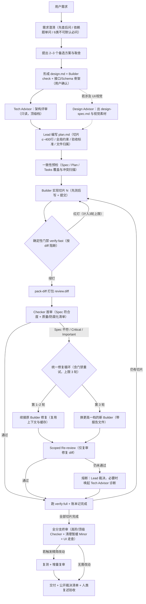

# 多 Agent 协同开发架构规范（最终定稿）

> **定位**：面向中大型、需长期维护软件项目的星形多 Agent 工程规范。
> **核心目标**：在**设计质量、开发质量、Token 消耗、长期可维护性**四者之间建立可持续的平衡，且与具体大模型及特定工具生态解耦。
> **收纳原则**：核心正文仅保留 **Day 1 级、零/极低维护成本、防不可逆损失** 的条款；需要持续维护的工具链、分阶段护栏与具体通道协议均收录在附录，按触发信号延迟引入。

---

## 一、架构总览与核心原则

**一句话概括：一条写入线程、以文件为中心交接、按 S/M/L 三级路由、设设计与验收两道质量闸门、配统一修复循环与熔断阶梯，外加防不可逆腐化的机械护栏。**

### 七条第一性原则
1. **以 Token 换质量，而非天然省钱**：多 Agent 架构存在冷启动、规范重读与汇总开销，必须先做任务分级（Effort Scaling），简单任务由主控单线程直出。
2. **单写者原则（Single-Writer）**：每次代码改动都隐含设计决策，多 Agent 并行写同一模块极易产生语义冲突。读操作（检索、调研、审查、诊断）可自由并行；写操作默认串行，仅在文件归属完全正交时才允许并行。
3. **高压缩比隔离**：只有“产生大量中间噪声，但最终只需精炼结论或明确改动”的任务，才值得隔离到子 Agent 独立上下文中，防止主线程出现注意力衰减（Context Rot）。
4. **文件化交接与双层沉淀**：派发提示词与子 Agent 回复会常驻主上下文并在后续每轮重复计费。临时过程状态落盘于 `.agent/`（抗上下文压缩、合入即删），长期架构真相沉淀于 `docs/` 与根指令文件，主线程只传路径与精炼摘要。
5. **按预期轮次而非单价选能力档位**：极轻量模型在多步任务上往往多跑 2–3 倍轮次，总消耗与返工成本反而高于中阶模型。应按任务确定性与预期轮次匹配能力档位。
6. **独立视角与客观验证**：执行者存在自评偏差（Confirmation Bias）；但“零历史上下文”不等于“零需求上下文”，验收角色必须拿到明确的需求约束。优先采用异构模型家族交叉审查，降低同源盲区。
7. **不可逆边界机械化，其余护栏按复发生长**：散文式规范长期必然漂移。对**不可逆损失**（持久化 Schema、对外契约、护栏配置、依赖膨胀）在 Day 1 设硬红线；对其他坏味道坚持**“同类问题复发第 2 次再升级为机械规则”**，避免过度工程化。

---

## 二、三层配置架构

无论底层使用何种支持自定义子 Agent 的 CLI 或 IDE 工具，均遵循以下三层职责分离：

1. **第一层：全局运行边界**
   - 控制默认能力档位、最大并发子 Agent 数量，以及**最大嵌套层级（严格限定为 1 层：仅主控可派发子 Agent，禁止子 Agent 二次派发）**。
2. **第二层：角色专属配置（管“怎么干活”）**
   - 每个角色独立成文件，写死其能力档位、思考强度、工具权限边界（宿主层硬禁止只读角色编辑文件，且**护栏配置文件不进任何执行者的写入归属**）、角色方法论与结构化回传契约。
   - 保持角色提示词前缀稳定，以最大化前缀缓存命中率，避免主控每次派活重复粘贴规范。
3. **第三层：按需调度规范（管“何时派谁”）**
   - 仅定义任务分级判据、路由规则、上下文注入策略、修复循环上限与熔断裁决规则，不混入具体编码或审查细则。

---

## 三、角色体系与契约（4 常驻 + 2 按需顾问）

保持常驻研发核心精简为 **4 个角色**，将高杠杆但低频的专家能力拆为 **2 个正交的按需顾问**，防止角色膨胀导致主控路由失准。

| 角色                          | 定位与职责边界                                                                                      | 工具与权限                                                                 | 抽象能力档位                                                             | 派发输入                                                       | 回传契约（进入主上下文）                                                                                                                                                   |
| :-------------------------- | :------------------------------------------------------------------------------------------- | :-------------------------------------------------------------------- | :----------------------------------------------------------------- | :--------------------------------------------------------- | :------------------------------------------------------------------------------------------------------------------------------------------------------------- |
| **Lead（主控）**                | 需求澄清、方案设计、编写 `plan.md`、账本维护、裁决与最终验收；**S/M 级亲自写代码，L 级只协调不写代码**                                | 完整读写 + 高风险操作                                                          | **中高阶综合档**（全体系成本与质量锚点）                                             | 用户原始需求与交互                                                  | 阶段交付 + 公开裁决清单 + L 级变更叙事                                                                                                                                        |
| **Scout（侦察）**               | 大规模代码库探索、入口与调用链定位、大体积日志/测试报错提纯、外部调研（**少量已知文件查找由 Lead 直接完成**）                                 | **严格只读**（仅允许只读查询与检索命令）                                                | **极速轻量档**（大输入、低延迟、高缓存友好）                                           | 单一明确问题 + 搜索范围；已知文件/现象仅作线索                                  | 原始发现落盘至 `.agent/findings/`；仅回传 `≤ 1.5k Token` 摘要（`path:line` + 片段证据 + 关系结论），**必须显式标注“未找到 / 不确定”**                                                              |
| **Builder（施工）**             | 按单个任务 brief 落地实现并完成**内层验证循环**：先写测试（修 Bug 先写复现测试）→ 实现 → 跑 `verify:fast` → 提交；严格遵守**公开接口测试约定** | **受限读写**（仅限 brief 指定的文件归属集合；**宿主拒写护栏配置**；禁削弱测试断言）                     | **按轮次分层**：<br>• 完整代码/单文件机械修改 → **轻量档**<br>• 文字描述的多文件实现 → **中阶执行档** | brief 路径 + 前序已定接口 + 歧义裁定 + 报告路径                            | 完整记录写入 `task-N-report.md`，测试日志写入 `.agent/logs/`；仅回传 `≤ 800 Token`：**4 种状态之一**（`DONE` / `DONE_WITH_CONCERNS` / `NEEDS_CONTEXT` / `BLOCKED`）+ 提交记录 + 一行测试摘要 + 顾虑 |
| **Checker（验收）**             | **外层独立验收**：对照需求约束检查 **① Spec 符合度** 与 **② 质量/精简/防腐化核对清单**；涉界面变更时实际运行应用做行为验证                   | **严格只读**（可执行验证或浏览器测试，严禁改源码）                                           | **最低中阶推理档**，按风险升档；L 级终审用**高阶/顶级档**；**推荐与 Lead/Builder 异构**         | brief 路径 + report 路径 + 独立 diff 文件 + **原文照抄的全局约束**（零实现过程历史） | `≤ 1.5k Token`：Spec 裁定（通过/不通过）+ 问题按 `Critical / Important / Minor` 分级 + `⚠️ 仅凭 diff 无法验证` 项 + **“复发第 2 次提议机械化”字段**；存疑项须自我核验后再报                                 |
| **Tech Advisor（技术顾问，按需）**   | ① L 级后端/系统架构设计评审 ② 修复循环熔断后的疑难根因诊断 ③ 高影响技术决策（数据模型/并发/安全）                                      | **严格只读**                                                              | **顶级深度推理档**（建议按次指定）                                                | 完整背景 + 架构约束 + **完整失败记录与已排除假设**（与 Checker 注入策略相反）           | `≤ 1.5k Token`：独立架构方案（ADR 草案）或根因诊断与最小破局路径                                                                                                                      |
| **Design Advisor（设计顾问，按需）** | ① 涉界面需求（含 M/L 级前端）动手前定视觉基调与交互规范 ② 生成配图/图标/视觉参考素材 ③ 页面实现后看运行态截图做审美走查（Design QA）               | 读图 + 原生生图 + 仅写 `.agent/design-spec.md` 与 `.agent/assets/`（**不改业务源码**） | **强审美多模态 + 原生生图档**                                                 | 产品目标、用户场景、参考图，或运行态页面截图                                     | `.agent/design-spec.md`（配色/字体/间距 Token 与交互规范）、素材路径、或审美走查清单                                                                                                     |

### 全局硬规则
1. **显式指定能力档位**：每次派发必须明确角色对应的能力档位与思考强度，防止默认继承主线程的高阶配置。
2. **严禁嵌套派发**：任何子 Agent 不得私自拉起助手或审查者。
3. **默认全新上下文**：`Scout`、`Checker`、`Design Advisor` 均以零对话历史启动；`Tech Advisor` 须注入完整失败轨迹；返工时优先续接原 `Builder` 会话以复用缓存。
4. **人工介入的 5 条唯一红线**：正常执行计划时持续推进不频繁打断用户，仅在以下情况暂停请示：
   - ① 不可逆或破坏性操作；
   - ② 安全敏感操作；
   - ③ 影响当前工作区以外的外部动作（合并、推送共享分支、发布）；
   - ④ 计划存在严重缺陷以致每条推进路径都只能靠猜；
   - ⑤ **触及持久化 Schema / 数据库迁移、对外公开契约（API/事件格式）、护栏配置（lint/类型/架构/CI 规则），或引入新的第三方依赖**。
5. **跨 Agent 协同通道选型准则**（与具体协议解耦，具体工具方案见附录 B）：
   - 任何跨工具或跨模型调用通道必须同时满足 5 项基准：**结构化输出、可恢复会话、可声明只读沙箱、Token/费用可计量、版本可锁定并可冒烟验证**。

---

## 四、任务分级路由（S / M / L）

由 Lead 在任务启动时判定级别（满足高一级别任一条件即升级；用户明确指令“直接改”且不触发人工红线时可按 S 级执行）：

| 级别 | 判定标准 | 执行路径 | 预期子 Agent 投入 |
| :--- | :--- | :--- | :--- |
| **S（小活）** | 已知 1–2 个目标文件，改动小，无跨模块影响，不触及 Schema/契约 | Lead 直接修改 → 跑 `verify:fast` → 交付 | **0 次** |
| **M（常规）** | 需先定位代码；或涉及 3–10 个文件；或存在一定逻辑/界面风险 | （仅大规模探索时派 Scout）→ 涉界面则派 Design Advisor 定视觉规范 → Lead 写简版 plan 并**亲自实现**（同类跨文件批量小改可合并派给单个 Builder）→ `verify:fast` 通过后派 Checker 审一轮 → 谁写谁修 → 复测交付 | **1–3 次** |
| **L（复杂）** | 跨模块改造、从 0 到 1 新建系统/特性、触及持久化 Schema / 对外契约 / 核心架构决策、或需求存在显著歧义 | 完整设计关（含人类审定接口骨架）→ `plan.md` 与一致性预检 → 逐切片串行执行「Builder → `verify:fast` → Checker → 修复循环 → 记账」→ 切片完成跑 `verify:full` → 顶级全分支终审 → 公开裁决与复述验收交付 | **按切片数线性可控** |

---

## 五、端到端工作流、确定性门禁与修复熔断

### 5.1 L 级任务完整闭环



### 5.2 核心流转与门禁细则
1. **精简确定性门禁（Shift-Left）**：
   - 将固定、零方差的检查交给确定性脚本/Hook，只保留三项哑节点：**`verify:fast / verify:full` 分档命令**、**`pack-diff` 打包**、**“门禁红灯禁止唤醒 Checker”**。
   - **按 diff 范围阻断**：所有质量门禁一律仅拦截本次改动新增的违规，严禁因存量债务逼迫 Builder 越出文件归属边界；存量问题记录为后续重构项。
   - **重试计入统一上限**：门禁红灯引起的自修与 Checker 触发的修复共享 **3 轮总上限**，超限立即报 `BLOCKED` 交由 Lead 介入（遇到不稳定测试 flaky 先隔离再排查）。
2. **谁写谁修**：M 级由 Lead 写、Lead 修；L 级由 Builder 写，发现问题必须续接原 Builder 修复，严禁 Lead 在 L 级流程中亲自下场改代码。
3. **修复循环与分级处理**：
   - `Minor` 级问题不进入修复循环，直接记入账本为 `deferred minor`，交由最终全分支审查统一处置。
   - 仅 `Spec 不符`、`Critical`、`Important` 或确认成立的 `⚠️ 无法验证项` 触发修复循环。
   - **复审只看修复部分的增量 diff**，不扩大审查范围；修复中偶发发现的域外问题记入账本，不延长当前循环。
4. **Checker 首审可核对防腐化清单**（仅在首审执行，不得带入增量复审）：
   - 是否绕过仓库现有公共原语/黄金样板另起炉灶？
   - 是否引入新第三方依赖（是否已有 `Ruling`）？
   - 是否触及持久化 Schema / 迁移 / 对外契约（是否经人工确认）？
   - 测试是否 mock 了自己拥有的内部模块，或偷偷削弱了既有断言？
   - 是否改动了护栏配置文件，或新增了抑制注释（`suppression`）？
   - 是否为了机械追求 DRY 而引入了带开关参数的错误抽象？
   - 若仓库已建立 `docs/glossary.md`，是否引入了表内“禁用别名”或与标准术语冲突的新命名？
   - *分级规则*：默认按 `Minor` 计；一旦触及 Schema/契约/护栏配置/测试作弊，直接升为 `Important` 阻断；**同类问题若已在项目内第 2 次出现，在回传中显式标注“提议机械化为规则”**。
5. **精简（Simplify）安全红线**：精简必须严格保持外部可观测行为、错误处理、边界校验与安全检查等价；一旦触及源码，必须重新执行验证命令并追加一次增量复审。
6. **不预设结论与验证防作弊**：派发 Checker 时严禁写“不要标记 X”等引导语句；Checker 不重跑 Builder 已在相同 commit 上跑过的测试，但必查测试文件 diff。
7. **额度耗尽与基础设施中断恢复**（详见 [额度耗尽与故障恢复推演手册](./fault-recovery.md)）：额度耗尽、429 限流或通道超时属于基础设施中断，**不计入 3 轮质量修复上限**，但独立限制最多切换 1 次同档位备选通道（仍失败则暂停通知开发者）；**严禁因断粮对 `Checker` / 顾问静默降级或跳过验收**；`Builder` 断粮后须先核查 `git status / diff`，残缺半成品直接回滚至 `BASE` 干净重跑，绝不在脏现场盲叠补丁。

---

## 六、双层文档与文件化交接协议

严格区分**“临时过程交接件”**与**“随仓库长期演进的架构资产”**，修复合并清理后决策知识丢失的缺口：

### 6.1 长期架构资产（纳入版本控制，永久维护）
```text
AGENTS.md                    # 根目录单一精简指令文件（建议 ≤150 行）：核心命令、黄金样板路径、依赖白名单、不可违背红线
docs/
├── ARCHITECTURE.md          # 模块地图与边界说明（可由脚本校验与实际目录一致）
├── glossary.md              # 领域统一语言表（标准术语 / 本项目定义 / 禁用别名）；M/L 级项目首次设计核心数据模型时创建
└── adr/
    └── XXXX-<title>.md      # 架构决策记录：仅记录「难以逆转」的决策；能机械化则配结构测试，不能则写明复核触发条件
```
- **供给侧防负向模仿**：由于后续 Agent 会把现有代码当成 Few-shot 样本复制，必须在 `AGENTS.md` 中直接指向仓库内各类模式的**黄金样板实现**（分层、错误处理、测试范本）；尚待重构的遗留代码集中放入明确标注“禁止模仿”的目录或加文件头注释。
- **依赖白名单**：在 `AGENTS.md` 中维护“每类基础问题只选用一个库”的白名单，防止 Agent 反复引入重复库或幻觉包名（Slopsquatting）。
- **领域统一语言（`docs/glossary.md`）**：固定于 **M/L 级项目首次设计核心数据模型时**由 Lead 创建（S 级小项目不建），仅维护当前项目特有的核心业务术语、项目内定义与**禁用别名（Aliases to avoid）**，不抄录业界通用技术名词；后续随核心概念演进增量维护，供开发者、Lead、Builder 与 Checker 共同对齐，防止跨会话命名漂移。

### 6.2 临时过程交接目录（加入 `.gitignore`，合入主干后清理）
```text
.agent/
├── design.md                # L 级：已确认的技术方案与接口骨架（区分开发者原话与 Lead 假设，过 Builder check 与 Tech Advisor 评审）
├── design-spec.md           # 涉界面需求：视觉基调、Design Token 与交互规范（Design Advisor 产出）
├── assets/                  # Design Advisor 生成的配图、图标与视觉参考
├── plan.md                  # 切片清单、全局硬约束、验收标准、文件写入归属
├── ledger.md                # 进度账本 / Ruling 裁决记录 / deferred minor 列表
├── tasks/
│   ├── task-N-brief.md      # 单个切片的完整需求（从 plan 提取，唯一事实来源）
│   ├── task-N-report.md     # Builder 完整实现报告（修复轮次按序追加）
│   └── task-N-review.diff   # pack-diff 生成的单一审查包（提交列表 + stat + diff）
├── findings/                # Scout 的原始探索与调研笔记
└── logs/                    # 完整构建与测试原始日志（严禁直接灌入任何对话上下文）
```

### 6.3 最小派发模板与账本规范
- **派发 5 要素**（主上下文仅保留这几行）：① 一句话任务定位；② `task-N-brief.md` 路径（注明数值/签名原样照用）；③ 前序切片已定但 brief 未含的增量接口；④ 对已知歧义的明确裁定；⑤ `task-N-report.md` 路径与极简回传格式。
- **抗压缩账本**：每完成一切片立即追加 `Task <N>: complete (commits <base7>..<head7>, review clean / <K> parked)`；上下文压缩后以 `ledger.md` 和 `git log` 为唯一进度基准。
- **公开裁决**：所有自主决断记为 `Ruling: <决定> — <理由> — <若判断错误的代价>`，交付时按序全量列出，杜绝静默决策。

---

## 七、Token 成本、质量防线与长期可维护性

### 7.1 Token 控制 10 条（按收益从高到低）
1. **S 级不派子 Agent**：省掉一切不必要的冷启动与编排开销。
2. **文件传参，禁粘历史 + 阶段压缩**：主上下文绝不粘贴前序任务的累积摘要；L 级任务经过多轮澄清签字落盘 `design.md` / `plan.md` 后，动工前主动提醒开发者可在当前窗口执行 `/compact`（不换窗口即可清掉前序废案噪声，防进入上下文衰减区）。
3. **按轮次匹配档位**：多步文字 spec 用中阶保一次通过率，仅高确定性机械改动降到极轻量档。
4. **同类小改合并批处理**：多文件同构小修改合并为一次派发与一次审查。
5. **续接会话返工**：前 2 轮修复复用原 Builder 会话，保留上下文与前缀缓存。
6. **门禁前置 + 增量复审 + 过滤 Minor**：门禁红灯零 Token 打回，复审只喂修复 diff，Minor 延后汇总。
7. **日志与大 diff 落盘**：完整测试输出进 `.agent/logs/`，仅回传退出码与最小报错切片。
8. **前缀稳定保缓存**：角色规范固化在第二层配置中，会话中途不修改根指令文件，动态内容追加在末尾。
9. **采用星形主从，弃用网状自由对话**：日常开发不启用多 Agent 自由互聊的网状团队。
10. **严格封顶循环与并发**：统一修复上限 ≤ 3 轮、禁止嵌套派发、按独立审查视角数量决定 Checker 数量。

### 7.2 不可逆边界与长期防腐化防线（Day 1 必守）
1. **数据模型与对外契约（重构最昂贵的地基）**：
   - 持久化 Schema、公开 API、事件格式变更默认按 **L 级 + 人工红线**处理；
   - 数据库迁移**只进不改**（禁止修改已应用的迁移），破坏性变更严格走**扩张-收缩（Expand/Contract）**两步；
   - 单一真相源自动生成类型（Schema / 接口定义 → 代码类型），禁止手写平行类型。
2. **测试策略硬约定（防止脆弱测试锁死重构）**：
   - **只通过模块公开接口测试**，测行为而非内部结构；
   - **禁止 mock 自己拥有的内部模块**，仅 mock 进程外边界（第三方 API、时钟、随机数）；
   - 数据库测试使用真实引擎（嵌入式或容器），不用 mock repository；
   - 对既有代码做重构前，先补齐**特征测试（Characterization / Golden Tests）**。
3. **护栏的护栏（防止 AI 绕过规则）**：
   - 护栏配置文件（lint / 类型 / 架构 / CI / 阈值 / baseline）**绝不进入 Builder 写入归属**，变更须人工批准；
   - **Day 1 启用 `suppression` 计数棘轮**：类型忽略、lint 禁用、宽泛动态类型占位与跳过测试的总数**只准降、不准升**；
   - 任何新增自定义静态规则，必须附带一份**反例测试夹具**（已知违规代码必须触发失败）。
4. **对抗认知债的可执行纪律**：
   - **人定骨架，AI 填肉**：L 级切片的接口签名、类型与 Schema 经人类审定后 Builder 再实现；
   - **小批量可审 diff**：单切片/单 PR 控制在 **~400 行有效改动以内**，超限则拆切片；
   - **复述验收**：L 级交付附一页变更叙事与模块影响图，人类能明确回答“改了哪条边界、新增了哪个不变量、如何回滚”方算验收通过；
   - 小提交 + 规范化提交信息，保证 `git revert` 可干净回滚且 `git log` 可作为高质量后续上下文。

---

## 八、反模式清单（明确禁止）

| 反模式 | 导致的工程后果 |
| :--- | :--- |
| 把前序历史摘要粘进后续派发提示词 | 主上下文永久膨胀，后续每轮重复为无用历史买单 |
| 所有子 Agent 一刀切用最便宜档位 | 多步任务轮次暴涨、误报泛滥，总成本与耗时反升 |
| L 级任务由 Lead 亲自修复审查问题 | 污染主控上下文，且修复内容直接绕过独立审查 |
| 多个 Builder 并行写入同一模块 | 隐含设计决策冲突，合并与返工代价远超并行收益 |
| 把 Checker 与 Tech Advisor 合二为一 | 上下文注入策略相反（零历史 vs 带失败史）、调用频次与目标冲突 |
| 用全仓级门禁（全仓重复率/行数上限/全仓死代码）阻断单次切片 | 逼迫 Builder 越出文件归属边界，或诱发“带开关参数的伪 DRY”与无意义碎文件 |
| 放任 AI 编写 mock 掉内部模块的单元测试 | 测试与内部实现强耦合，后续每次重构大面积报错，反而抬高重构成本 |
| 允许 Builder 修改护栏配置或随意插入抑制注释 | 护栏形同虚设，技术债静默累积 |
| 在审查提示词中写“不要标记某问题” | 预先下结论，独立验收退化为橡皮图章 |
| 不维护外部账本直接跑长程任务 | 上下文压缩后遗忘进度，整批重派已完成切片 |

---

## 九、渐进落地与周期调优

### 四阶段落地顺序（切忌一次全上）
1. **第一阶段（只读提质 + Day 1 底线）**：建立精简根 `AGENTS.md` + Day 1 机械底线（格式化/严格类型/无循环依赖/`suppression` 棘轮/`verify:fast`）+ 配置 **Checker** 与 **Scout**。
2. **第二阶段（控成本与抗压缩）**：加入 **S/M/L 分级路由**、`.agent/plan.md` + `ledger.md` 账本，以及与长期 `docs/` 的双层分离。
3. **第三阶段（跑通闭环）**：引入 **Builder**、3 轮统一修复熔断循环与 `pack-diff`。
4. **第四阶段（拔高设计上限）**：补齐 **Tech Advisor** 与 **Design Advisor**，完善 L 级设计闸门与 UI 视觉走查。

### 周期调优 4 项指标
调优铁律：**发现问题先查派发说明（Brief）和路由规则，最后才考虑给角色升档能力。**

| 观测指标 | 异常信号说明什么 | 优先调整动作 |
| :--- | :--- | :--- |
| **单任务总 Token（区分缓存命中/未命中）** | 分级偏重、日志泄漏进上下文，或前缀频繁变动破坏缓存 | 收紧 S/M 判定阈值；核查日志落盘与角色配置稳定性 |
| **Builder 一次通过率 / 平均修复轮次** | Brief 规格含糊、切片过大，或对文字 spec 误用了过轻档位 | 缩小切片粒度（≤~400 行）、补全 Brief 契约，或将多文件任务升至中阶档 |
| **Checker 发现采纳率（误报率）** | 未注入全局约束、未执行存疑核验，或 Checker 档位过低 | 强制抄送全局约束、开启核验步骤，或换用异构高阶档 |
| **变更扩散度（单需求触及文件数）与交付后缺陷** | 模块边界开始腐化、验收标准缺失，或跳过前置设计评审 | 触发对应阶段的架构护栏升级；补齐验收标准与复述验收 |

### 触发式环境复盘（交付前可选收尾）
- **触发条件**：仅在 **L 级任务执行坎坷**时触发（触发过 3 轮熔断、Builder 反复踩同类环境坑，或 Scout 定位关键文件明显绕弯）；S/M 级与顺畅完成的任务一律跳过，避免形式主义。
- **执行时机与输入**：在合并交付并清理 `.agent/` 临时目录**之前**执行；基于 `.agent/ledger.md`、发生返工的 `task-*-report.md` 及 `.agent/logs/` 关键报错摘要，**只审仓库环境摩擦，不重复审代码 diff**。
- **3 个检查维度**：① **导航缺口**（找文件/黄金样板绕弯 → 补 `AGENTS.md` 或 `docs/ARCHITECTURE.md` 路径指针）；② **自动化门禁缺口**（本可由 `verify:fast` / lint / 类型检查自动拦截的失误 → 补确定性检查）；③ **规则与术语升级**（高频踩坑升级为机械规则，或补充 `docs/glossary.md`）。
- **只提不改原则**：仅输出 **3–5 条**按收益排序的环境改进提案；优先改造脚本、门禁与导航指针，**禁止**将 `AGENTS.md` 写成冗长的“教训日记”；严禁擅自修改 `AGENTS.md`、CI 或护栏配置，必须经开发者逐条批准后再落改。

---

## 附录 A：长期可维护性护栏的三阶段按需引入表

> 原则：不在 Day 1 堆砌重型工具，严格按**触发信号**升级护栏，避免护栏本身的维护成本反噬开发效率。

| 阶段 | 引入项 | 触发信号（满足任一即升级至该阶段） |
| :--- | :--- | :--- |
| **Day 1 必装**<br>*(任何项目，搭建 < 半天)* | • 格式化 + Lint 自动修复 + 类型严格模式（边界处解析校验）<br>• 单一 `verify:fast` 接入 pre-commit / 宿主 Hook / CI<br>• **仅“无循环依赖”1 条**架构规则<br>• 护栏配置宿主拒写 + **`suppression` 计数棘轮**<br>• 公开接口测试约定 + 第 5 条人工红线<br>• 根 `AGENTS.md`（≤150 行，含命令 + 黄金样板 + 依赖白名单）<br>• 小提交 + 规范化提交信息 | 项目启动即启用 |
| **成长期**<br>*(按信号延迟引入)* | • 2–3 条分层不变量规则（只写实际疼过的：如领域核心不依赖框架/IO、UI 不直连持久层）<br>• **仅 diff 范围阻断**的死代码/孤儿导出检查<br>• **单文件增长棘轮**（超 ~500 行的老文件只准变小不准变大）+ 函数长度/圈复杂度上限<br>• `docs/adr/`（仅记难以逆转决策）+ 模块间契约测试<br>• `verify:fast / full` 分档 | • 代码量超过 ~1 万行；或<br>• 出现第 2 位协作者/并行写线程；或<br>• 同类边界违规被 Checker 指出 ≥2 次；或<br>• 单需求变更扩散度持续上升；或<br>• 首次出现“改 A 坏 B”回归 |
| **大型长期演进** | • 重复度检测（先仅报告，再对 **diff 新增大克隆 ≥50 行**阻断，排除测试/生成代码；由 Checker 按“三次法则”裁决是否抽象）<br>• 核心逻辑**按月抽样变异测试**（揪出空心测试）<br>• 触发式 **G 级园艺重构**（见附录 C）<br>• 模块级下沉 `AGENTS.md`（仅约定确有不同的子域）<br>• 将重复违规 ≥2 次的流程纪律升级为哑脚本 | • 代码量超过 ~5 万行；或<br>• 多人/多 Agent 高频并行；或<br>• 同一 Bug 在重复代码中修了 2 次；或<br>• L 级任务成为常态 |

---

## 附录 B：跨 Agent 协同通道选型参考

在满足正文 §3 五条通道准则（结构化输出、可恢复、只读沙箱、可计量、可锁版本）的前提下，按实际场景选择对应通道：

| 使用场景 | 推荐通道 | 工程落地要点 |
| :--- | :--- | :--- |
| **同一运行时/厂商内**的常规子 Agent | **宿主原生子 Agent** | 零桥接成本，优先复用统一沙箱与文件锁 |
| **跨厂商异构审查 / 专家会诊**（低频、粗粒度） | **硬化 CLI 桥接**（默认首选） | 为每个下游官方 CLI 写 ≤50 行薄封装：强制开启结构化 JSON 无头输出 + 显式只读沙箱参数 + 超时与退出码校验 + 结果落盘 `.agent/`；**锁定 CLI 版本**并配 1 条冒烟测试；既让异构模型在原生 harness 中满血发挥，也最大程度符合各厂商订阅使用条款 |
| **跨厂商多模型高频统一管理**（使用 API/聚合网关） | **原生多模型单运行时** | 用声明式角色文件 + 细粒度 `permissions` 沙箱直接切换底层模型；注意评估模型脱离原生 harness 后的工具调用折损 |
| **驻留支持开放客户端协议的 IDE**，需多 Agent 交互 UI | **ACP（Agent Client Protocol）** | 视作**人类交互 UI 层**而非无人值守编排底座（部分 CLI 仍经适配器接入，无人值守下审批只能自动放行） |
| **短时、同步、只读的单点咨询** | **厂商官方暴露的极简 MCP**（≤2 工具） | 需防范同步超时、Token 不可计量及下游自带文件权限越界问题，必须确保被调方显式只读；慎用大而全的第三方多模型 MCP 套件 |
| **异步、长耗时、可审计的独立任务** | **Git 分支 / PR 作为异步总线** | 天然持久化、人类在环审查、零额外协议维护成本 |

> *说明*：面向跨组织、跨网络服务的自治 Agent 发现协议（如 A2A）不属于本地单仓协同编码范畴，不纳入本规范。

---

## 附录 C：触发式园艺熵减流程（G Mode）

用于大型长期演进项目定期消除技术债与文档漂移，**采用触发驱动而非固定日历驱动**：

- **触发条件**：完成重要里程碑、变更扩散度显著上升、或静态扫描累计存量债务超过阈值。
- **前置硬条件**：目标重构区域**必须已有特征测试或契约测试覆盖**；未覆盖则先补测试再重构，禁止盲改。
- **执行流程**：
  1. 确定性扫描器输出存量债务清单（死代码、重复簇、超长文件、依赖告警）；
  2. Lead 按风险排序，严格控制迭代预算（如 ≤20% 周期投入），切分为单 PR ≤400 行的纯行为等价重构切片；
  3. 走标准 `Builder → verify:full → Checker` 闭环，遵守单写者原则（不与功能开发同时修改同一模块）；
  4. 同步执行 **Doc Gardening**：核查 `docs/ARCHITECTURE.md`、`docs/glossary.md`、`docs/adr/` 与 `AGENTS.md` 是否与最新代码漂移，及时修剪过时描述。

---

> 配套溯源文档：[逐章参考来源索引](./references.md)
> 配套交互细则：[人类介入与主动询问规范](./human-in-the-loop.md)
> 配套故障手册：[额度耗尽与故障恢复推演手册](./fault-recovery.md)

