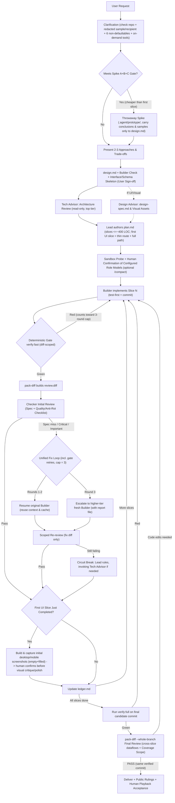

# Multi-Agent Development Architecture Specification

**English** | [简体中文](../zh-CN/architecture.md)

> **Scope:** A star-topology multi-agent engineering specification for medium-to-large, long-lived software repositories.
> **Core Goal:** Achieve a sustainable balance across **design quality, implementation quality, token cost, and long-term maintainability**, decoupled from specific LLM models and host tool ecosystems.
> **Inclusion Principle:** The main specification retains only **Day-1, zero/ultra-low-maintenance, irreversibility-preventing** rules. Ongoing toolchains, phased guardrails, and concrete bridge protocols live in the Appendices and are adopted only when explicit trigger signals appear.

---

## 1. Architecture Overview & First Principles

**In one sentence: a single write thread, file-centered handoffs, S/M/L effort-scaling routing, two quality gates (design & independent verification), a unified fix loop with a circuit breaker, and mechanical guardrails against irreversible rot.**

### Seven First Principles
1. **Trade tokens for quality—do not assume multi-agent saves money by default:** Multi-agent orchestration carries cold-start, spec re-read, and aggregation overhead. Always apply effort scaling first; handle simple edits directly on the Lead thread.
2. **Single-Writer Principle:** Every code edit embeds implicit design decisions; parallel writers editing the same module create semantic conflicts. Read operations (search, exploration, review, diagnosis) parallelize freely; writes are serial by default and parallelize only across strictly disjoint file ownership.
3. **High-Compression Isolation:** Isolate a task into a subagent's fresh context only when it generates heavy intermediate noise yet yields a concise summary or concrete diff, preventing Context Rot in the primary thread.
4. **File-Based Handoffs & Two-Tier Persistence:** Dispatch prompts and subagent replies persist in Lead's context and are re-billed on every subsequent turn. Store ephemeral per-feature state in `.agent/` (compaction-resistant, deleted on merge) and long-term architecture truth in `docs/` plus root instructions; pass only file paths and crisp summaries across the main thread.
5. **Select Capability Tiers by Expected Turns, Not Unit Token Price:** Ultra-cheap models often burn 2–3× more turns on multi-step tasks, costing more in total tokens and rework than a mid-tier model. Match capability tier to task determinism and expected turn count.
6. **Independent Perspective & Objective Verification:** Implementers suffer from confirmation bias; however, "zero implementation history" does **not** mean "zero requirements context"—reviewers must receive explicit global constraints. Prefer cross-family heterogeneous models for review to reduce shared blind spots.
7. **Mechanize Irreversible Boundaries; Grow Other Guardrails on Recurrence:** Prose guidelines inevitably drift over time. Enforce hard Day-1 red lines on **irreversible losses** (persistent schemas, public contracts, guardrail configs, dependency sprawl). For all other code smells, follow **"promote to a mechanical rule on the 2nd recurrence"** to avoid over-engineering.

---

## 2. Three-Layer Configuration Architecture

Regardless of the underlying CLI or IDE supporting custom subagents, separate configuration into three clean layers:

1. **Layer 1: Global Runtime Boundaries**
   - Controls default capability tier, maximum concurrent subagents, and **maximum nesting depth (strictly 1: only Lead may spawn subagents; nested delegation is forbidden)**.
2. **Layer 2: Role Profiles ("How to Work")**
   - One dedicated file per role fixing its capability tier, reasoning effort, tool permission boundaries (host-enforced read-only restrictions; **guardrail configs excluded from every implementer's write scope**), methodology, and structured return contract.
   - Keep role prompt prefixes stable to maximize prompt cache hit rates and avoid re-pasting rules on every dispatch.
3. **Layer 3: On-Demand Orchestration Spec ("When to Dispatch Whom")**
   - Defines only task sizing criteria, routing rules, context injection policies, fix-loop caps, and escalation/ruling protocols—never mixing in detailed coding or review checklists.

---

## 3. Role System & Contracts (4 Core + 2 On-Demand Advisors)

Keep the core delivery loop lean at **4 roles**, and split high-leverage, low-frequency expertise into **2 orthogonal on-demand advisors** to prevent role bloat from degrading Lead's routing accuracy.

| Role | Scope & Responsibility | Tools & Permissions | Abstract Capability Tier | Dispatch Input | Return Contract (Enters Lead Context) |
| :--- | :--- | :--- | :--- | :--- | :--- |
| **Lead** | Requirement clarification, design, authoring `plan.md`, ledger maintenance, rulings & final acceptance; **implements S/M directly, orchestrates only on L** | Full read/write + high-risk actions | **Upper-mid general tier** (cost & quality anchor) | Raw user intent & interactive feedback | Milestone delivery + full `Ruling:` list + L-level change narrative |
| **Scout** | Large-codebase exploration, entry-point & call-chain tracing, verbose log/test distillation, external research (**Lead reads small sets of known files directly**) | **Strictly read-only** (read/search commands only) | **Fast lightweight tier** (large input, low latency, cache-friendly) | Single clear question + search scope; known files/symptoms as leads only | Raw findings written to `.agent/findings/`; return `≤ 1.5k tokens` (`path:line` + snippet evidence + conclusions), **explicitly flagging "not found / uncertain"** |
| **Builder** | Executes a single task brief and runs the **inner verification loop**: tests first (repro test first for bugs) → implement → run `verify:fast` → commit; obeys **public-interface testing rules** | **Scoped read/write** (brief's file ownership only; **host denies guardrail config edits**; no assertion weakening) | **Tiered by turn shape:**<br>• Mechanical / single-file spec → **Lightweight tier**<br>• Prose multi-file spec → **Mid execution tier** | Brief path + settled prior interfaces + ambiguity rulings + report path | Full log in `task-N-report.md`, test output in `.agent/logs/`; return `≤ 800 tokens`: **1 of 4 statuses** (`DONE` / `DONE_WITH_CONCERNS` / `NEEDS_CONTEXT` / `BLOCKED`) + commit SHA + 1-line test summary + concerns |
| **Checker** | **Outer independent verification:** evaluates **① Spec compliance** and **② Quality / simplification / anti-rot checklist**; exercises live UI when UI changes | **Strictly read-only** (may run verification or browser checks; never edits source) | **Minimum mid reasoning tier**, escalating with risk; **high/frontier tier** for L-level final review; **heterogeneous model family recommended** | Brief path + report path + standalone diff file + **verbatim global constraints** (zero implementation history) | `≤ 1.5k tokens`: Spec verdict (pass/fail) + issues graded `Critical / Important / Minor` + `⚠️ Cannot verify from diff` items + **"2nd recurrence — propose mechanization" tag**; self-verify doubtful findings before reporting |
| **Tech Advisor** *(on-demand)* | ① L-level backend/system architecture review ② Root-cause diagnosis after fix-loop circuit break ③ High-impact decisions (data modeling / concurrency / security) | **Strictly read-only** | **Top deep-reasoning tier** (invoked selectively per occasion) | Full context + architecture constraints + **complete failure history & ruled-out hypotheses** (opposite of Checker's injection policy) | `≤ 1.5k tokens`: independent architecture recommendation (ADR draft) or root-cause diagnosis with minimal unblock path |
| **Design Advisor** *(on-demand)* | ① Visual direction & interaction tokens before UI work (M/L frontend) ② Image/icon/reference asset generation ③ Runtime screenshot Design QA after implementation | Vision + native image generation + write only to `.agent/design-spec.md` & `.agent/assets/` (**never edits app source**) | **High-aesthetic multimodal + native image tier** | Product goals, user flows, reference images, or runtime screenshots | `.agent/design-spec.md` (color/type/spacing tokens & interaction rules), asset paths, or Design QA checklist |

### Global Hard Rules
1. **Explicit Capability Tiers:** Every dispatch must explicitly specify capability tier and reasoning effort—never accidentally inherit Lead's high-tier defaults.
2. **No Nested Delegation:** No subagent may spawn its own helpers or reviewers.
3. **Fresh Context by Default:** Start `Scout`, `Checker`, and `Design Advisor` with zero conversation history; inject full failure traces into `Tech Advisor`; resume the original `Builder` session during rework to preserve prompt cache.
4. **The Only 5 Human-in-the-Loop Red Lines:** Execute plans continuously without interrupting the user; pause and ask **only** when hitting:
   - ① Irreversible or destructive operations;
   - ② Security-sensitive operations;
   - ③ Actions with side effects outside the workspace (merge, push to shared branches, deploy/publish);
   - ④ Severe plan failure where every path forward is a guess;
   - ⑤ **Changes to persistent schemas / database migrations, external public contracts (APIs/events), guardrail configs (lint/type/arch/CI rules), or adding a new third-party dependency.**
5. **Cross-Agent Channel Criteria** *(protocol-agnostic; concrete options in Appendix B)*:
   - Any cross-tool or cross-model bridge must satisfy 5 baselines: **structured output, resumable sessions, enforceable read-only sandboxing, measurable token/cost usage, and lockable versions with a smoke test**.

---

## 4. Effort-Scaling Task Routing (S / M / L)

Lead classifies each task at intake (any single trigger from a higher tier upgrades the task; explicit user instruction to "just edit it" without hitting a red line may stay S-level):

| Level | Criteria | Execution Path | Expected Subagent Calls |
| :--- | :--- | :--- | :--- |
| **S (Small)** | 1–2 known target files, tiny change, no cross-module impact, no schema/contract changes | Lead edits directly → run `verify:fast` → deliver | **0** |
| **M (Medium)** | Needs code discovery; or touches 3–10 files; or carries moderate logic/UI risk | (Scout only if large-repo exploration needed) → Design Advisor if UI-facing → short plan → Lead **implements directly** (or batches same-shape multi-file edits to 1 Builder) → `verify:fast` green → 1 Checker pass → author fixes → retest & deliver | **1–3** |
| **L (Large)** | Cross-module refactor, 0→1 feature/system, touches persistent schema / public contracts / core architecture, or high requirement ambiguity | Full design gate (with human sign-off on interface skeletons) → `plan.md` & consistency pre-check → serial per-slice loop (`Builder → verify:fast → Checker → fix loop → ledger`) → `verify:full` → top-tier whole-branch final review → public rulings & playback acceptance | **Linear & bounded by slice count** |

---

## 5. End-to-End Workflow, Deterministic Gates & Circuit Breaker

### 5.1 Complete L-Level Loop



### 5.2 Core Flow & Gate Rules
1. **Lean Deterministic Shift-Left Gates:**
   - Offload fixed, zero-variance checks to deterministic scripts/hooks; keep only three dumb nodes: **tiered `verify:fast / verify:full`**, **`pack-diff`**, and **"red gate blocks invoking Checker"**.
   - If a single sandboxed tool fails (e.g. `esbuild` `EPERM`), propose offloading only that failing step to the host while keeping working sandbox static checks (such as typecheck/lint) intact—never ban all sandbox checks globally.
   - **Diff-Scoped Blocking:** Every automated gate blocks **only violations introduced by the current diff**. Never let pre-existing tech debt force Builder outside its file ownership; log pre-existing issues for future refactoring.
   - **Unified Retry Cap:** Self-fixes triggered by gate failures and fixes triggered by Checker share the **3-round total cap**. Exceeding the cap immediately emits `BLOCKED` for Lead intervention (quarantine flaky tests before debugging).
2. **Author Fixes Own Code:** On M-level tasks, Lead writes and fixes; on L-level tasks, Builder writes and the original Builder is resumed to fix—Lead never edits code directly inside an L-level loop.
3. **First UI Slice & Initial Screenshot Gate:** UI slices stay within the ~400-LOC budget. Place a **thin runnable route + one end-to-end user path** into the **first UI slice** so the first build verifies production output, framework config drift, and desktop/mobile empty + filled states together. **Always show initial screenshots to the human for confirmation before starting blind visual critiques or multi-round polish**; drive rework by reproducible defects (escalate rubric disagreement to the human; keep blind critics fresh and reuse the fixer session).
4. **Severity-Graded Fix Loop:**
   - `Minor` items never enter the fix loop; log them in `ledger.md` as `deferred minor` for final whole-branch disposition.
   - Only `Spec mismatch`, `Critical`, `Important`, or confirmed `⚠️ Cannot verify` findings trigger the fix loop.
   - **Scoped Re-review:** Re-reviews inspect **only the incremental fix diff**. Incidental out-of-scope findings go to the ledger without extending the current loop.
5. **Checker Initial-Review Anti-Rot Checklist & Whole-Branch Final Review Contract** *(initial checklist never enters scoped re-reviews)*:
   - Did the change bypass existing repository primitives or golden exemplars?
   - Did it introduce a new third-party dependency without a `Ruling`?
   - Did it touch persistent schemas / migrations / public contracts without human approval?
   - Did tests mock owned internal modules or weaken existing assertions?
   - Did it edit guardrail configs or introduce new suppressions?
   - Did it introduce a flag-parameter wrong abstraction chasing premature DRY?
   - If `docs/glossary.md` exists, did it introduce any listed "aliases to avoid" or drift from canonical project domain terms?
   - *Grading Rule:* Default to `Minor`; escalate immediately to blocking `Important` when touching schemas/contracts/guardrails/test integrity. **If the same defect recurs a 2nd time in the repo, explicitly tag "Propose promoting to a mechanical rule".**
   - *Whole-Branch Final Review Contract:* Always build the final package with `pack_diff --whole-branch --base <BRANCH_BASE> --head HEAD --dataflow ...` containing the complete commit history and file inventory (never treat a last-slice diff as whole-branch evidence). Checker spot-checks cross-slice contracts along critical end-to-end dataflows in live files and explicitly discloses **Coverage Scope** (directly inspected vs. relied on via prior slice reviews/tests).
6. **Simplification & Post-Edit Re-Verification Loop:** Any source edit from simplification, visual polish, or whole-branch review MUST re-run `verify:full` (and re-check impacted areas) so the delivered commit is the exact verified green commit.
7. **No Prejudiced Prompts & Anti-Cheat Verification:** Never write "do not flag X" in Checker prompts. Checker does not re-run tests Builder already passed on the same commit, but **must inspect test file diffs**.
8. **Model / Quota / Sandbox Outage Recovery (No Same-Tier Fallbacks)** *(see [Fault Recovery Runbook](./fault-recovery.md))*: Quota exhaustion, 429 rate limits, runner timeouts, and sandbox failures are infrastructure failures—they **do not consume the 3-round quality cap**. **No same-tier fallback models are configured, and auto-switching or silent downgrading is strictly forbidden.** Pause immediately, present the exact error and concrete options for human decision (if the human chooses a different Builder, confirm a cross-provider independent Checker). After a Builder outage, inspect `git status / diff` first and discard only confirmed Builder-authored incomplete edits without auto-reverting pre-existing user files.

---

## 6. Two-Tier Documentation & File-Based Handoffs

Strictly separate **ephemeral per-feature handoffs** from **long-lived versioned architecture assets**, preventing architectural knowledge loss when `.agent/` is cleaned up after merge:

### 6.1 Long-Term Architecture Assets (Version-Controlled, Permanently Maintained)
```text
AGENTS.md                    # Single lean root instruction file (target <=150 lines): core commands, golden exemplar paths, dependency allowlist, non-negotiable red lines
docs/
├── ARCHITECTURE.md          # Module map & boundary rules (verifiable by script against actual directories)
├── glossary.md              # Project ubiquitous language (Term / Definition / Aliases to avoid); created when an M/L project first designs core data models
└── adr/
    └── XXXX-<title>.md      # Architecture Decision Records: only hard-to-reverse decisions; pair with structural tests where mechanizable, or state review triggers
```
- **Supply-Side Anti-Imitation:** Because future agents copy existing code as few-shot examples, point `AGENTS.md` directly to **golden exemplar implementations** (layering, error handling, test style). Quarantine legacy code awaiting refactor in directories explicitly marked "do not imitate" or with file header notices.
- **Dependency Allowlist:** Maintain a "one library per foundational concern" allowlist in `AGENTS.md` to prevent duplicate libraries and hallucinated packages (slopsquatting).
- **Domain Ubiquitous Language (`docs/glossary.md`):** Fixed creation trigger—authored by Lead **when an M/L-level project designs its core data models for the first time** (skipped for S-level projects). Records only project-specific business terms, project definitions, and **aliases to avoid** (never copy generic industry dictionary terms); updated incrementally as core concepts evolve so the developer, Lead, Builder, and Checker stay aligned against cross-session naming drift.

### 6.2 Ephemeral Handoff Directory (`.gitignore`d, Cleaned After Merge)
```text
.agent/
├── design.md                # L-level: confirmed tech design & interface skeletons (user words vs. Lead assumptions separated; passed Builder check & Tech Advisor)
├── design-spec.md           # UI work: visual tone, design tokens & interaction spec (Design Advisor)
├── assets/                  # Images, icons & visual references generated by Design Advisor
├── plan.md                  # Slice list, global hard constraints, acceptance criteria, file ownership
├── ledger.md                # Progress ledger / Ruling records / deferred minor list
├── tasks/
│   ├── task-N-brief.md      # Complete spec for slice N (extracted from plan; single source of truth)
│   ├── task-N-report.md     # Builder full implementation report (fix rounds appended in order)
│   └── task-N-review.diff   # Single review bundle generated by pack-diff (commits + stat + diff)
├── findings/                # Scout raw exploration & research notes
└── logs/                    # Full build/test/CLI raw logs (never paste into any conversation context)
```

### 6.3 Minimal Dispatch Template & Ledger Rules
- **5-Item Dispatch Prompt** *(keep only these lines in Lead context)*: ① one-line task positioning; ② path to `task-N-brief.md` (explicitly noting literals/signatures verbatim); ③ incremental interfaces settled by prior slices not yet in brief; ④ explicit rulings on known ambiguities; ⑤ `task-N-report.md` path + minimal return format.
- **Compaction-Resistant Ledger:** Immediately after each slice completes, append `Task <N>: complete (commits <base7>..<head7>, review clean / <K> parked)`. After context compaction, `ledger.md` and `git log` are the sole progress truth.
- **Public Rulings:** Log every autonomous judgment as `Ruling: <decision> — <rationale> — <cost if wrong>` and present all entries in chronological order on delivery—zero silent decisions.

---

## 7. Token Cost, Quality Defenses & Long-Term Maintainability

### 7.1 Top 10 Token Controls (Ordered by ROI)
1. **Zero subagents for S-level work:** Eliminates unnecessary cold starts and orchestration overhead.
2. **File-based handoffs, no pasted history + phase compaction:** Never paste accumulated summaries of prior tasks into Lead context; on L-level tasks, once multi-turn clarification is signed off into `design.md` / `plan.md`, remind the developer they may run `/compact` in-place before slice execution to drop rejected design chatter and stay out of the context-degradation zone.
3. **Match tier to expected turn count:** Use mid-tier for prose multi-file specs to maximize first-pass success; drop to ultra-lightweight only for deterministic mechanical edits.
4. **Batch homogeneous micro-edits:** Combine small same-shape edits across files into one Builder dispatch and one review.
5. **Resume sessions on rework:** Rounds 1–2 reuse the original Builder session to preserve context and prompt cache.
6. **Shift-left gates + incremental re-review + filter Minors:** Reject gate failures at zero LLM token cost; feed only fix diffs on re-review; defer Minors to final review.
7. **Offload logs & large diffs to disk:** Write verbose test logs to `.agent/logs/`; return only exit code and minimal failure excerpts.
8. **Stable prefixes for cache hits:** Freeze role instructions in Layer 2, never mutate root instructions mid-session, and append dynamic content at the end.
9. **Star topology over free-form mesh chat:** Avoid multi-agent mesh chatter in routine engineering.
10. **Hard caps on loops & concurrency:** Unified 3-round fix cap, zero nested delegation, and spawn multiple Checkers only per distinct independent review perspective.

### 7.2 Irreversible Boundaries & Day-1 Anti-Rot Defenses
1. **Data Models & Public Contracts (Most Expensive to Refactor):**
   - Treat persistent schema, public API, and event format changes as **L-level + human red line** by default;
   - Database migrations are **append-only** (never edit applied migrations); breaking changes strictly follow **Expand/Contract**;
   - Generate code types from a single source of truth (Schema / IDL → types); forbid hand-written parallel types.
2. **Testing Hard Conventions (Prevent Brittle Tests from Freezing Refactors):**
   - **Test through public module interfaces only**—assert behavior, not internal structure;
   - **Never mock owned internal modules**—mock only out-of-process boundaries (third-party APIs, clock, RNG);
   - Use real database engines (embedded or containerized) rather than mock repositories;
   - Write **Characterization / Golden Tests** before refactoring legacy code.
3. **Guardrails for the Guardrails (Prevent AI Bypass):**
   - Guardrail configs (lint / types / arch / CI / thresholds / baselines) **never enter Builder's write ownership**; edits require human approval;
   - **Day-1 `suppression` count ratchet:** Total count of type ignores, lint disables, wide dynamic escape hatches, and skipped tests may **only decrease, never increase**;
   - Every new custom static rule must ship with a **negative test fixture** proving known violating code fails the check.
4. **Executable Discipline Against Cognitive Debt:**
   - **Human defines the skeleton, AI fills the flesh:** Interface signatures, core types, and schemas are approved by the human before Builder implements;
   - **Reviewable batch sizes:** Keep each slice/PR under **~400 effective LOC**; split if larger;
   - **Playback acceptance:** L-level deliveries include a one-page change narrative and module impact map; acceptance passes only when the human can clearly state "which boundary changed, what invariant was added, and how to roll back";
   - Small, conventional commits so `git revert` works cleanly and `git log` remains high-signal future context.

---

## 8. Anti-Patterns (Explicitly Forbidden)

| Anti-Pattern | Engineering Consequence |
| :--- | :--- |
| Pasting prior-task summaries into subsequent dispatch prompts | Permanently bloats Lead context; pays repeatedly for dead history on every turn |
| Defaulting every subagent to the cheapest model tier | Turn counts explode on multi-step specs, false positives surge, total cost & latency rise |
| Lead directly fixing review issues inside an L-level flow | Pollutes orchestrator context and lets fixes bypass independent verification |
| Multiple Builders writing to the same module in parallel | Conflicting implicit design decisions; merge and rework costs dwarf parallel gains |
| Merging Checker and Tech Advisor into one role | Opposite context-injection strategies (zero history vs. full failure trace), conflicting cadence & goals |
| Blocking a single slice with repo-wide gates (repo duplication / line caps / repo-wide dead code) | Forces Builder outside file ownership or induces flag-parameter pseudo-DRY and fragmented files |
| Allowing AI to write unit tests mocking owned internal modules | Tightly couples tests to implementation details, making every future refactor break tests |
| Letting Builder edit guardrail configs or insert suppression comments freely | Guardrails become theater while tech debt silently accumulates |
| Writing "do not flag X" in Checker prompts | Prejudices the verdict and turns independent verification into a rubber stamp |
| Running long-horizon tasks without an external ledger | Context compaction wipes progress tracking, causing whole batches of completed slices to be re-run |

---

## 9. Incremental Rollout, Periodic Tuning & Environment Retros

### Four-Phase Rollout (Never Adopt Everything at Once)
1. **Phase 1 (Read-Only Quality + Day-1 Baseline):** Create lean root `AGENTS.md` + Day-1 mechanical baseline (formatter / strict types / no circular deps / `suppression` ratchet / `verify:fast`) + configure **Checker** and **Scout**.
2. **Phase 2 (Cost Control & Compaction Resilience):** Add **S/M/L routing**, `.agent/plan.md` + `ledger.md`, and separation from long-term `docs/`.
3. **Phase 3 (Closed Delivery Loop):** Introduce **Builder**, the unified 3-round fix & circuit-break loop, and `pack-diff`.
4. **Phase 4 (Design Ceiling):** Add **Tech Advisor** and **Design Advisor**, completing L-level design gates and UI Design QA.

### Four Periodic Tuning Metrics
Golden rule of tuning: **When quality drops, audit the dispatch Brief and routing rules first—upgrade model tiers last.**

| Metric | Warning Signal | Priority Adjustment |
| :--- | :--- | :--- |
| **Total tokens per task (cache hit vs. miss)** | Over-heavy sizing, raw logs leaking into context, or unstable prefixes breaking cache | Tighten S/M thresholds; audit log offloading and Layer-2 prompt stability |
| **Builder first-pass rate / avg fix rounds** | Ambiguous Brief, oversized slice, or too-light tier used for prose spec | Shrink slices (≤~400 LOC), tighten Brief contracts, or move multi-file specs to mid tier |
| **Checker finding acceptance rate (false-positive rate)** | Missing global constraints, skipped self-verification, or under-powered Checker tier | Copy global constraints verbatim, enforce self-verification, or switch to a stronger heterogeneous tier |
| **Change spread (files touched per feature) & escaped defects** | Module boundaries rotting, weak acceptance criteria, or skipped design reviews | Trigger next guardrail phase; tighten acceptance criteria and playback verification |

### Triggered Environment Retro (Optional Pre-Cleanup Step)
- **When to trigger:** Only after a **bumpy L-level run** (tripped the 3-round circuit breaker, Builder repeatedly hit environment friction, or Scout took major detours locating files). Skip on S/M tasks and smooth L runs to avoid ceremony.
- **Timing & Inputs:** Run **before** merging and deleting `.agent/`. Inspect `.agent/ledger.md`, reworked `task-*-report.md` files, and key `.agent/logs/` failure excerpts—**audit repository/process friction only, never re-review the final code diff**.
- **Three Inspection Areas:** ① **Navigation gaps** (detours finding files/exemplars → add pointers to `AGENTS.md` or `docs/ARCHITECTURE.md`); ② **Missing deterministic checks** (mistakes `verify:fast` / lint / types should have caught → add automated checks); ③ **Rules & terminology upgrades** (promote recurring friction to mechanical rules or add entries to `docs/glossary.md`).
- **Proposal-Only Rule:** Output at most **3–5 prioritized environment proposals**. Prefer scripts, gates, and navigation pointers—**never** turn `AGENTS.md` into a bloated "lessons diary". Never auto-edit `AGENTS.md`, CI, or guardrail configs; apply only items explicitly approved by the developer.

---

## Appendix A: Three-Stage Maintainability Guardrails (Trigger-Driven)

> Principle: Do not pile heavy static tooling onto Day 1. Upgrade guardrails strictly on **trigger signals** so guardrail maintenance never outweighs development velocity.

| Stage | Additions | Trigger Signals (Upgrade when any holds) |
| :--- | :--- | :--- |
| **Day 1 Mandatory**<br>*(any repo, < half-day setup)* | • Formatter + lint autofix + strict type-checking (boundary validation)<br>• Single `verify:fast` wired to pre-commit / host hook / CI<br>• **Only 1 architectural rule:** no circular dependencies<br>• Host write-denial on guardrail configs + **`suppression` count ratchet**<br>• Public-interface testing convention + Red Line #5<br>• Root `AGENTS.md` (≤150 lines: commands + golden exemplars + dependency allowlist)<br>• Small commits + conventional commit messages | Active from project start |
| **Growth Stage**<br>*(deferred until signaled)* | • 2–3 layering invariant rules (only ones that actually hurt: e.g., domain core free of framework/IO; UI never hits persistence directly)<br>• **Diff-scoped** dead-code / orphan-export checks<br>• **Single-file growth ratchet** (legacy files >~500 LOC may only shrink) + function length / cyclomatic complexity limits<br>• `docs/adr/` (hard-to-reverse decisions only) + inter-module contract tests<br>• Split `verify:fast / full` | • Codebase exceeds ~10k LOC; or<br>• 2nd contributor / parallel writer joins; or<br>• Same boundary violation flagged by Checker ≥2 times; or<br>• Change spread steadily rising; or<br>• First "fix A broke B" regression |
| **Large Long-Lived Stage** | • Duplication detection (report-only first, then block **new diff clones ≥50 lines**, excluding tests/generated code; Checker adjudicates abstraction by Rule of Three)<br>• **Monthly sampled mutation testing** on core logic (exposes hollow tests)<br>• Triggered **G-Mode Gardening Refactors** (see Appendix C)<br>• Sub-module `AGENTS.md` (only where subdomains genuinely diverge)<br>• Promote process disciplines violated ≥2 times into dumb scripts | • Codebase exceeds ~50k LOC; or<br>• High-frequency multi-human / multi-agent parallelism; or<br>• Same bug fixed twice in duplicated code; or<br>• L-level tasks become routine |

---

## Appendix B: Cross-Agent Channel Selection Reference

Subject to the 5 channel criteria in §3 (structured output, resumability, read-only sandbox, cost metering, lockable versions), pick the right bridge per scenario:

| Scenario | Recommended Channel | Engineering Notes |
| :--- | :--- | :--- |
| Routine subagents **within the same runtime/vendor** | **Host-native subagents** | Zero bridge overhead; reuses unified sandbox and file locking |
| **Cross-vendor heterogeneous review / advisor** (low-frequency, coarse-grained) | **Hardened CLI bridge** *(default choice)* | Thin ≤50-line wrapper per official CLI: structured JSON headless output + explicit read-only sandbox flags + timeout/exit-code validation + raw output to `.agent/`; **pin CLI versions** and keep 1 smoke test; preserves native harness quality and respects vendor subscription terms |
| **High-frequency multi-model orchestration** (API / aggregator gateways) | **Single multi-model runtime** | Declarative role files + granular `permissions` sandboxes to switch models; watch for tool-calling degradation outside a model's native harness |
| **IDE with open client protocol** needing interactive multi-agent UI | **ACP (Agent Client Protocol)** | Treat as a **human-interactive UI layer**, not an unattended orchestration backbone |
| **Short, synchronous, read-only point consultations** | **Minimal official vendor MCP** (≤2 tools) | Guard against sync timeouts, opaque token accounting, and unintended downstream file permissions; avoid kitchen-sink third-party multi-model MCP suites |
| **Asynchronous, long-running, auditable independent tasks** | **Git branches / PRs as async bus** | Naturally persistent, human-reviewed, zero extra protocol maintenance |

> *Note:* Cross-organization autonomous agent discovery protocols (such as A2A) fall outside local single-repo collaborative coding and are excluded from this specification.

---

## Appendix C: Triggered Gardening & Entropy Reduction (G Mode)

Used in large long-lived repositories to periodically drain tech debt and documentation drift—**trigger-driven, never calendar-driven**:

- **Trigger Conditions:** Major milestone completion, noticeable rise in change spread, or static scan debt backlog crossing threshold.
- **Hard Precondition:** Target refactor zone **must already be covered by characterization or contract tests**. If uncovered, write tests first—never refactor blind.
- **Execution Flow:**
  1. Deterministic scanners produce the backlog (dead code, clone clusters, oversized files, dependency warnings);
  2. Lead prioritizes by risk within a strict cycle budget (e.g., ≤20% effort), slicing into behavior-preserving PRs ≤400 LOC each;
  3. Execute via standard `Builder → verify:full → Checker` loop under single-writer rules (never overlap active feature edits on the same module);
  4. Run **Doc Gardening** in sync: audit `docs/ARCHITECTURE.md`, `docs/glossary.md`, `docs/adr/`, and `AGENTS.md` against current code and prune stale descriptions.

---

> Companion Reference Index: [Section-by-Section Reference Index](./references.md)
> Companion Interaction Spec: [Human-in-the-Loop & Clarification Specification](./human-in-the-loop.md)
> Companion Outage Playbook: [Quota Exhaustion & Fault Recovery Runbook](./fault-recovery.md)
