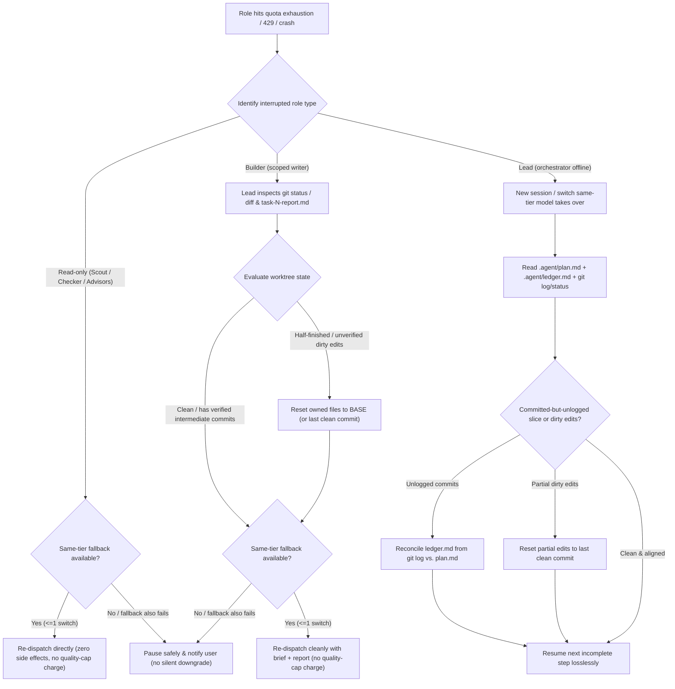

# Multi-Agent Collaboration: Quota Exhaustion & Fault Recovery Runbook

**English** | [简体中文](../zh-CN/fault-recovery.md)

> **Parent Specifications:** [Multi-Agent Development Architecture Specification](./architecture.md) · [Human-in-the-Loop & Clarification Specification](./human-in-the-loop.md)
> **Scope:** Standard operating procedures (Runbook) for lossless recovery whenever any role encounters **quota exhaustion, rolling rate limits (429), empty credit balances, or abrupt process interruption** mid-task.

---

## 1. Built-In Fault-Tolerance Baseline

The deadliest failure in multi-agent workflows is losing progress, looping endlessly, or polluting main with half-written code. Four baseline design choices naturally cap the **blast radius of any outage to the single in-flight action**:

1. **Disk-Backed State (`.agent/` + `ledger.md`):** Designs, task briefs, review diffs, progress ledgers, and rulings live on disk rather than volatile conversation memory.
2. **Small-Commit Checkpoints (`git log`):** Every accepted slice lands as an isolated commit, giving an exact clean rollback anchor at all times.
3. **Single-Writer Principle:** At most one write thread mutates source code at any instant—eliminating multi-writer merge disasters when a runner dies mid-flight.
4. **Idempotent Read-Only Roles:** `Scout`, `Checker`, and `Tech Advisor` hold zero source write permissions; retrying after an outage has zero side effects.

---

## 2. Three Ironclad Outage Rules

Whenever any role hits quota exhaustion or rate-limiting mid-run, enforce these three hard rules:

1. **Separate Infrastructure Failures from the Quality Fix Cap**
   - The **3-round fix circuit breaker** measures code quality and gate convergence only;
   - Quota exhaustion, HTTP 429 rate limits, and runner timeouts are **infrastructure failures and do NOT consume the 3-round quality cap**;
   - Infrastructure retries have their own cap: **at most 1 switch to a same-tier fallback**. If the fallback also fails, pause immediately and notify the developer to switch accounts or wait for quota reset—never spin in a tight retry loop.
2. **No Silent Downgrades or Skipped Verification**
   - If `Checker`, `Tech Advisor`, or `Design Advisor` runs out of quota without a same-tier fallback, Lead is **strictly forbidden** from quietly downgrading to an ultra-lightweight model or skipping verification to "keep moving";
   - Safely pause and wait for quota recovery rather than compromising the quality gate.
3. **Inspect & Reset Dirty Worktrees—Never Patch Blindly Over Half-Built Code**
   - After any write-capable role (`Builder`, or `Lead` writing directly on M-level) aborts mid-run, **always run `git status` and `git diff`** before resuming or re-dispatching;
   - Keep clean intermediate commits that already passed gates; if uncommitted partial edits or broken half-tests remain, **reset the slice's owned files cleanly back to `BASE`** and restart.

---

## 3. Fault Recovery Decision Flow

---

## 4. Per-Role Fault Injection Runbook (All 6 Roles)

### 1. `Scout` Outage
- **Risk:** Very low (zero workspace mutation).
- **Typical State:** Large-repo scan or log distillation cuts off before returning a summary; `.agent/findings/` may hold partial notes.
- **Recovery SOP:**
  1. Check `.agent/findings/` for any usable path leads and preserve them as hints;
  2. Switch once to a same-tier fast lightweight fallback to cover only remaining directories/questions;
  3. If the remaining scope has narrowed to a few known files, Lead reads them directly instead of re-dispatching.

### 2. `Checker` Outage
- **Risk:** Low (zero workspace mutation, high discipline needed against skipping).
- **Typical State:** `task-N-review.diff` and `task-N-brief.md` remain intact on disk; review output is missing or truncated.
- **Recovery SOP:**
  - **Initial slice review / final whole-branch review:** Switch once to a **same-tier or heterogeneous fallback** with the exact same `brief + report + review.diff + global constraints`;
  - **Scoped re-review:** Re-run with only the incremental fix diff and open findings list;
  - **Hard Red Line:** If no same-tier fallback is available, pause and wait—**never downgrade tiers or skip review to move to the next slice**.

### 3. `Tech Advisor` Outage
- **Risk:** Low (zero source mutation).
- **Typical State:** L-level architecture review or post-circuit-break root-cause diagnosis truncates mid-response.
- **Recovery SOP:**
  1. Switch once to an alternative top deep-reasoning fallback with full `.agent/design.md` or complete failure history and ruled-out hypotheses;
  2. If no other top-tier reasoning pool is available, **pause and inform the developer**—never let a low-tier model rubber-stamp an architecture review.

### 4. `Design Advisor` Outage
- **Risk:** Low (zero app-source mutation).
- **Typical State:** Three possible breakpoints—① `.agent/design-spec.md` half-written; ② only part of `.agent/assets/` generated; ③ runtime screenshot Design QA aborted.
- **Recovery SOP:**
  1. Partial spec: discard broken tail or instruct a fresh session to complete and validate consistency;
  2. Partial assets: inventory already-valid files in `.agent/assets/` and generate only the missing assets;
  3. Aborted Design QA: re-run on the exact same runtime screenshots with a same-tier multimodal fallback.

### 5. `Builder` Outage (Highest-Frequency Dirty Worktree)
- **Risk:** Medium (the only subagent that mutates application source).
- **Three Worktree States & Recovery:**
  1. **Case A (Zero edits / died while reading):** `git status` is clean—switch once to a same-tier fallback and re-dispatch `task-N-brief.md` without charging the 3-round quality cap.
  2. **Case B (≥1 clean commit already passed `verify:fast`, died during wrap-up or a fix round):**
     - Preserve the verified commits;
     - Discard uncommitted partial edits after `HEAD`;
     - Dispatch a fresh `Builder` with `task-N-brief.md` + `task-N-report.md` + `git log BASE..HEAD` to finish cleanly from `HEAD`.
  3. **Case C (Dirty uncommitted edits, half-written tests, or broken report):**
     - **Reset decisively:** Roll back only the slice's owned files to `BASE` (never delete `.agent/` plans or ledgers);
     - Re-dispatch cleanly from `BASE` on a fallback execution pool, eliminating hidden bugs from patching over broken partial logic.

### 6. `Lead` Outage (Orchestrator Offline)
- **Risk:** Medium-high (halts orchestration, but supports 100% lossless takeover).
- **Three Breakpoints & Takeover SOP:**
  1. **During Design Clarification:** Because answers are written to `.agent/design.md` immediately as settled, a fresh Lead reads `design.md` and continues only with remaining open items—never re-asking answered questions.
  2. **Between Slices / After Commit but Before Updating `ledger.md`:**
     - New Lead session executes a fixed **3-step takeover**:
       1) Read `.agent/plan.md` and `.agent/ledger.md`;
       2) Run `git status` and `git log --oneline -n 20`;
       3) Reconcile any committed-but-unlogged slices into `ledger.md` from `git log`; evaluate any M-level uncommitted half-edits under Builder Case C.
  3. **Hard Prohibition:** The incoming Lead must never guess progress from truncated chat memory—**`ledger.md` + `git log` are the sole source of truth**, preventing duplicate dispatch of completed slices.

---

## 5. Four Proactive Defenses Against Quota Outages

1. **Keep slices small (≤~400 effective LOC):** Smaller slices cap per-run token burn for both `Builder` and `Checker`, keeping rollback cost tiny if an outage strikes.
2. **Shift-left deterministic gates (`verify:fast`):** Catch formatting, typing, boundary, and unit-test failures locally at zero LLM token cost before waking `Checker`.
3. **Pre-wire same-tier fallback pools for critical roles:** Keep at least one alternate provider/quota pool ready for `Builder`, `Checker`, and `Tech Advisor` so rolling rate limits never stall delivery.
4. **Enforce S/M/L routing & log offloading:** Keep trivial edits and verbose build logs out of high-tier orchestrator pools, reserving scarce rolling quota for high-leverage design and verification gates.
