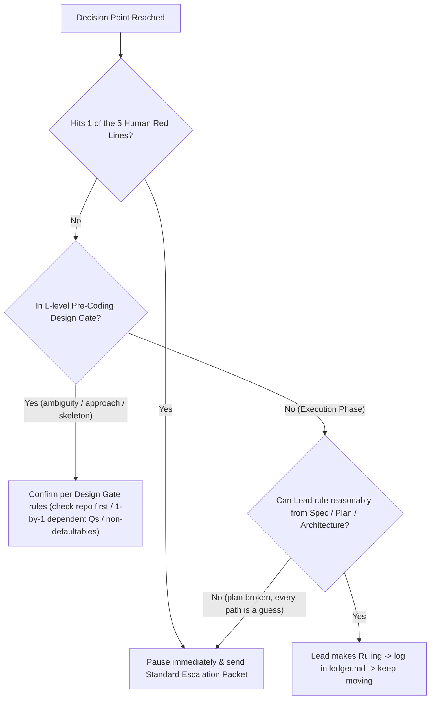

# Multi-Agent Collaboration: Human-in-the-Loop & Clarification Specification

**English** | [简体中文](../zh-CN/human-in-the-loop.md)

> **Parent Specification:** [Multi-Agent Development Architecture Specification](./architecture.md)
> **Core Principle:** **Clarify decisive boundaries before coding, execute continuously without chatter, pause only on the 5 irreversible red lines, and disclose every autonomous ruling on delivery.**
> **Design Goal:** Keep the developer **on-the-loop**—protecting flow from death-by-a-thousand-questions while preventing silent overreach that accumulates irreversible technical and cognitive debt.

---

## 1. Proactive Inquiry Matrix (By Task Level & Phase)

| Task Level | Pre-Coding (Design Phase) | During Execution (Build / Verify / Fix) | On Delivery (Sign-off Phase) |
| :--- | :--- | :--- | :--- |
| **S (Small)** | Do not ask; edit directly | Pause **only on the 5 red lines** | Deliver diff & `verify:fast` result; confirm external actions (merge/push) |
| **M (Medium)** | Skip if clear; confirm direction only for **UI/visual work** or decisive ambiguity | Pause **only on the 5 red lines** | Deliver diff, verification & `Ruling:` list; confirm external actions |
| **L (Large)** | **Mandatory 4-step gate:** ① Clarify unknowns (sample/optional Spike) → ② Choose approach → ③ Skeleton sign-off → ④ Confirm configured role models before Slice 1 | Pause on **5 red lines**, **initial screenshot confirmation after first UI slice**, or **model/sandbox failure** (never pause between routine slices or within 3-round self-fixes) | **Mandatory acceptance:** 1-page change narrative + all `Ruling:` entries + 3-question playback acceptance + external action confirmation |

### Human Intervention Decision Flow



---

## 2. Phase 1: Pre-Coding Confirmation (Design Gate)

Triggered before writing code on **L-level tasks** (or M-level tasks with core ambiguity / user-facing visual design) to eliminate the highest-cost rework before line 1:

1. **Requirement Clarification (Check First, Ask Dependent Questions One-by-One, Close by State)**
   - **Check before asking + real source of truth:** Never ask what the repository, spec, or prior conversation already answers; invite the user to share **one redacted sample** or state in one sentence **"who receives the output and what they do next"**; never reopen settled decisions.
   - **Questioning discipline & on-demand lightweight tools:** Ask only questions that change **what gets built** or **how it is accepted**, with a 1-line note on *what the answer changes*. Ask mutually dependent questions **one at a time**; batch mutually independent questions into one numbered message (≤3) or state them transparently as explicit assumptions. For solution-changing unknowns, pick only the needed tool—**input-to-deliverable contrast**, **discriminating rule examples**, or **shortest user path**—and reuse confirmed artifacts directly in `design.md` and tests (no mandatory multi-round forms or separate breadboard sign-offs). Ask "why" only when multiple reasonable intents lead to different designs (and omit options then to avoid anchoring).
   - **6 Non-Defaultable Items (Anti-Silent-Consent):** **Data irreversibility** (hard vs. soft delete, retention, migration), **permission boundaries**, **public contracts / schema identity**, **billing / quota / PII / compliance**, **non-goals**, and **acceptance criteria** (quantify vague adjectives or write testable cases). Never substitute assumptions for these six or bury them inside a bulk assumptions list; if offering a recommendation, recommend only the conservative, reversible choice.
   - **Close by state & post-sign-off change discipline:** Stop once no open question can change what gets built; move remaining items to `Deferred`. More than 5 solution-changing open questions signals the task should be split. When new preferences arise after sign-off, log impacted contracts and acceptance items in `ledger.md` and re-review strictly scoped to that impact surface.
   - **Chunked playback + write-as-you-go:** Play back understanding in 200–300 words per completed chunk; write confirmed answers directly into `.agent/design.md`, overwriting stale text and explicitly separating **"User's words"** from **"Lead's assumptions (with rationale)"**.
   - **Two escape hatches (`just build it` & Throwaway Spike A/B/C Gate):** If the developer did not ask for brainstorming, include an opt-out ("or say 'just build it'"); skipping writes all assumptions as `Ruling:` entries in `design.md`. Run a throwaway **Spike** only when **A (two plausible outcomes change contracts/dependencies/core interaction order) + B (still unresolved via repo/docs or user/sample and an experiment distinguishes them) + C (state 1 question, X/Y rule, and 5–10 min cap cheaper than the first real slice; otherwise shrink the first slice and mark provisional contracts + reopen criteria in `design.md`)** all hold. Pure local technical probes within existing permissions may run after logging a 2-line experiment card; ask the human first whenever user interaction, scope expansion, or extra budget is required. Keep prototypes in `.agent/prototype/` or a throwaway branch; never import, copy, or merge prototype code into production—Builders receive only conclusions and acceptance samples in `design.md`.
2. **Approach Trade-Offs (2–3 Distinct Options)**
   - Present **2–3** structurally distinct technical approaches with trade-offs, long-term maintenance cost, and a recommended option for the developer to pick.
3. **Skeleton Sign-Off & Pre-Execution Model Confirmation**
   - Before human sign-off, run a **context-free subagent** against `.agent/design.md` as a **Builder check** ("what is still missing to start implementing?"); combine its human-only questions into **one single message**—the only batched follow-up in this phase;
   - Finalize `.agent/design.md` plus core **interface signatures, core type definitions, and persistent schema skeletons** for explicit human confirmation before slicing for `Builder`;
   - For user-facing UI work, confirm `Design Advisor`'s visual direction and core interaction tokens (`.agent/design-spec.md`) at the design gate; once the first UI slice builds, present initial desktop/mobile screenshots for human confirmation before running blind visual critiques or multi-round polish;
   - **After sign-off and before Slice 1:** Run smoke tests and target sandbox probes, display each role's currently configured runner and model, and wait for explicit human confirmation before dispatching slices.

---

## 3. Phase 2: The Only 5 Human Red Lines During Execution

Once the design is signed off and execution begins, Lead **runs continuously through all slices**. Pause and escalate **only** when hitting one of these 5 red lines:

| Red Line | Category | Concrete Examples |
| :---: | :--- | :--- |
| **①** | **Irreversible or destructive operations** | Dropping tables/databases/history, bulk overwriting non-ephemeral assets, deleting uncommitted user files, irreversible data backfills |
| **②** | **Security-sensitive operations** | Changing auth/authz/permission models, touching secrets or production credentials, relaxing input validation/CORS/security policies |
| **③** | **External side effects outside the workspace** | Merging to main, pushing to shared remote branches, publishing/deploying, messaging external systems, or calling live paid/production endpoints |
| **④** | **Severe plan failure where every path is a guess** | Code reality invalidates core architectural assumptions, or spec and system contradict so deeply that even Lead cannot reasonably rule |
| **⑤** | **Four high-cost architectural mutations** | • **Persistent schemas / database migrations** (especially breaking changes);<br>• **External public contracts** (public APIs, SDKs, cross-service event schemas);<br>• **Guardrail configs** (lint / strict typing / arch boundary rules / CI gates / thresholds or baselines);<br>• **New third-party dependencies** outside `AGENTS.md`'s allowlist |

### Standard Escalation Packet Format
When pausing on a red line, **never drop a raw error or open-ended "what should I do?"**. Always deliver:
1. **Which red line was hit** (1 sentence stating location & fact);
2. **2 concrete options** (with blast radius, reversibility, and trade-offs);
3. **Lead's recommended choice & rationale** (so the developer can resume with "Option A / Option B / adjustment").

### Addendum: Pause Boundary on Model, Quota, or Sandbox Outages
When any role encounters model unavailability, quota exhaustion, HTTP 429 rate limits, or sandbox failure (see [Fault Recovery Runbook](./fault-recovery.md)):
- **No same-tier fallback models are configured, and auto-switching or silent downgrading is forbidden** (infrastructure failures do not consume the 3-round quality cap);
- Lead **must pause immediately** and report the concrete error plus 2–3 actionable options with trade-offs (e.g., wait for quota reset, switch to a human-approved model while keeping Builder and Checker on different providers, or offload only a failing sandboxed step to the host), then wait for the developer's decision—**never silently switch models or skip `Checker` just to avoid interrupting the user**.

---

## 4. Phase 3: Delivery Acceptance & Public Rulings

Once all slices pass final whole-branch review (plus any retests / Design QA), Lead requests final delivery confirmation with 3 mandatory items:

1. **One-Page Change Narrative & Module Impact Map (Mandatory on L-Level)**
   - Concisely summarize touched module boundaries, data flows, newly introduced architectural invariants, and rollback procedure.
2. **Complete Chronological `Ruling:` Ledger**
   - Surface every `Ruling:` recorded in `.agent/ledger.md` verbatim—zero hidden decisions:
     ```text
     Ruling: <decision made for you> — <basis & rationale> — <cost & rework path if wrong>
     ```
3. **3-Question Playback Acceptance & External Action Confirmation**
   - For L-level work, verify the developer can clearly answer three questions to prevent cognitive debt: ① **Which module/data boundary changed?** ② **What core invariant was added?** ③ **How do we roll back if it breaks?**
   - Only after acceptance does the developer authorize external actions (merge, push, release).

---

## 5. Inverse Boundary: 5 Situations Where Interrupting the User Is Forbidden

To prevent the agent from degenerating into a hand-holding intern, **never pause to ask the developer** in these 5 cases:

| Situation | Forbidden Behavior | Correct Handling |
| :--- | :--- | :--- |
| **1. Routine local details & minor ambiguities** | Asking about local variable names, helper splits, non-core error copy, or minor style | Lead rules from Spec + golden exemplars, logs a `Ruling:` in `ledger.md`, and proceeds |
| **2. Slice-to-slice handoffs** | Reporting progress after every slice and asking "Should I continue to the next task?" | Log completion in `ledger.md` and dispatch the next slice immediately |
| **3. Gate reds & review rejections within 3 rounds** | Calling for human rescue on the first compile error, failed test, or Checker rejection | Converge internally via the 3-round fix loop (Rounds 1–2 resume Builder; Round 3 escalates) |
| **4. `Minor` review suggestions** | Asking the human one-by-one whether to apply minor style tweaks | Park in `ledger.md` as `deferred minor` for final whole-branch disposition |
| **5. Circuit break without plan collapse** | Dumping every 3-round circuit break directly onto the developer | Lead diagnoses with `Tech Advisor` first; if safely resolvable or deferrable, issue a minimal `Ruling:` and proceed (interrupt only if it exposes **Red Line ④** or **Red Line ⑤**) |

---

## 6. Drop-In Lead Scheduling Constraint Template

Copy directly into root `AGENTS.md` or Lead's orchestration instructions:

```markdown
## Human-in-the-Loop & Escalation Rules
- **Before coding (L-level only):** Read the repo before asking; never ask what the repo/spec answers. Ask only questions that change what gets built or how it is accepted — dependent questions one at a time, independent ones batched (≤3) or stated as explicit assumptions. Never default on: data irreversibility, permission boundaries, public contracts/schema identity, billing/compliance, non-goals, acceptance criteria. Stop when nothing decisive is open (list the rest as Deferred), not at a fixed count. Play back understanding per chunk; write answers into `design.md` (user's words vs. your assumptions kept separate). Before sign-off, run a context-free builder check on `design.md` and batch its human-only questions in one message. Then present 2–3 approaches and get sign-off on `design.md` plus core interfaces/schemas.
- **During execution:** Execute continuously across all slices without asking "Should I continue?". Make rulings grounded in the spec for routine ambiguities and record every ruling in `.agent/ledger.md` as `Ruling: <decision> — <why> — <cost if wrong>`.
- **Stop and ask the human ONLY when hitting one of these 5 red lines:**
  1. Irreversible or destructive operations.
  2. Security-sensitive changes (auth, secrets, permission boundaries).
  3. Side effects outside the current workspace (merge, push to shared branch, deploy/publish).
  4. Severe plan failure where every path forward is a guess.
  5. Changes to persistent schemas/migrations, external public contracts, guardrail configs (lint/type/arch/CI), or adding a new third-party dependency.
- **When pausing:** Provide (1) which red line was hit, (2) 2 concrete options with trade-offs, and (3) your recommended choice.
- **On model/quota/sandbox failure:** Treat as infra failure (do not count against the 3-round quality cap). No same-tier fallback models are configured—never auto-switch, silently downgrade `Checker`/advisors, or skip verification. Pause immediately with the concrete error and 2–3 actionable options for the human's decision. Clean only confirmed Builder-authored incomplete mutations back to `BASE` before retrying (never revert pre-existing user edits).
- **On delivery:** Present all recorded `Ruling:` entries verbatim in chronological order, plus a one-page change narrative (boundaries changed, new invariants, rollback path) for L-level tasks.
```
