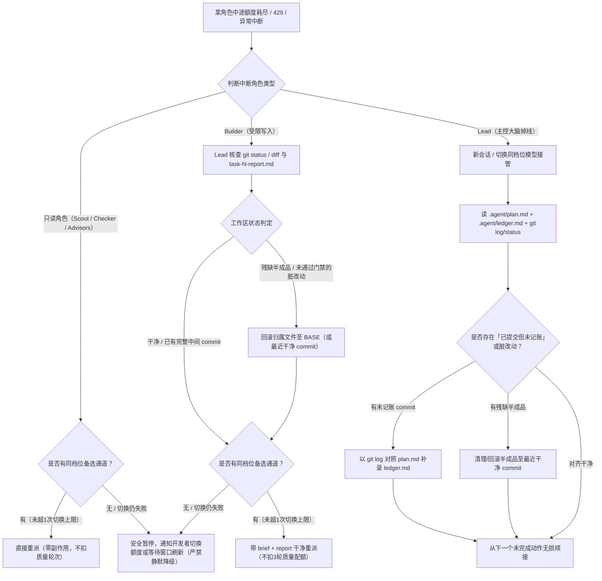

# 多 Agent 协同：额度耗尽与故障恢复推演手册

> **配套主规范**：[多 Agent 协同开发架构规范](./architecture.md) · [人类介入与主动询问规范](./human-in-the-loop.md)
> **适用场景**：任一角色在执行任务中途遭遇**额度耗尽、滚动时间窗口限流（429）、余额归零或进程异常中断**时的标准处置与无损恢复操作指南（Runbook）。

---

## 一、架构天然的容错基线

在多 Agent 协同中，最危险的故障是“中断导致进度丢失、反复重跑或代码半残污染主干”。本架构通过 4 项基础设计，天然将单次断粮的**爆炸半径锁死在“当前这一个未完成的动作”内**：

1. **状态全落盘（`.agent/` + `ledger.md`）**：方案、切片 brief、审查 diff、进度账本与裁决记录均在文件系统持久保存，不依赖易失的对话内存。
2. **小提交基准（`git log`）**：每个已通过验收的切片均已独立提交，任何时候都可准确对齐到最近一个干净 commit。
3. **单写者原则**：同一时刻最多只有一条写入线程在改代码，不会出现多个并发写者半途断粮导致的跨文件合并灾难。
4. **只读角色天然幂等**：`Scout`、`Checker`、`Tech Advisor` 均无源码写权限，中断重跑零副作用。

---

## 二、三条断粮防呆铁律

遇到任何角色中途额度耗尽或限流中断，必须严格遵守以下 3 条硬规则：

1. **基础设施中断与质量失败配额分离**
   - 规范中的 **“3 轮修复熔断上限”** 仅用于衡量代码质量与门禁是否收敛；
   - 额度耗尽 / 429 限流 / 通道超时属于**基础设施中断，不计入 3 轮质量配额**；
   - 但基础设施故障本身设独立重试上限：**最多切换 1 次同档位备选通道**；仍不可用则立即暂停，通知开发者切换账号或等待限流窗口重置，严禁死循环空刷。
2. **严禁静默降级或跳过验收（No Silent Downgrade）**
   - 当 `Checker`、`Tech Advisor` 或 `Design Advisor` 断粮且没有同档位备选时，**严禁** Lead 为了赶进度悄悄将其降级为极轻量档，更禁止直接跳过审查放行；
   - 宁可安全暂停等待额度恢复，也绝不牺牲质量防线。
3. **脏工作区先检后滚，绝不在半成品上盲叠补丁**
   - 任何写入角色（`Builder` 或 M 级亲写的 `Lead`）中途断粮后，恢复或重派前**必须先执行 `git status` 与 `git diff` 核查**；
   - 存在明确且完整的中间小提交时，从最新提交续接；若留下残缺未提交改动或半残测试，**直接回滚至切片起点 `BASE` 干净重跑**。

---

## 三、故障恢复决策流

---

## 四、6 大角色逐一故障注入推演（Runbook）

### 1. `Scout`（侦察）中途断粮
- **风险等级**：极低（零工作区污染）
- **典型现场**：大范围探索或大日志提纯中途断开，主控未收到摘要报告；`.agent/findings/` 可能留有半成品笔记。
- **恢复 SOP**：
  1. Lead 检查 `.agent/findings/` 是否已有部分落盘索引，有价值的路径线索可直接保留作为下一轮输入的线索；
  2. 切换同档位极速轻量备选重派，仅补充尚未覆盖的目录或问题；
  3. 若剩余范围已收缩到少数已知文件，Lead 可直接自行读取，不必强行再派。

### 2. `Checker`（验收）中途断粮
- **风险等级**：低（零工作区污染，但防偷跳过）
- **典型现场**：`task-N-review.diff` 与 `task-N-brief.md` 完整保存在盘上，审查报告未生成或输出截断。
- **差异化恢复 SOP**：
  - **任务级首审 / 全分支终审中断**：直接切换**同档位或异构备选通道**，喂入同一份 `brief + report + review.diff + 全局约束` 重新审查；
  - **增量复审（Scoped Re-review）中断**：仅喂入修复区间的增量 diff 与未关闭问题清单重跑；
  - **绝对红线**：若无同档位备选，必须暂停等待额度恢复，**绝不允许降档凑合或跳过审查直接推进下一切片**。

### 3. `Tech Advisor`（技术顾问）中途断粮
- **风险等级**：低（零源码污染）
- **典型现场**：L 级架构评审未输出完整方案，或 3 轮熔断后的根因诊断中断。
- **恢复 SOP**：
  1. 切换另一家顶级推理档位备选通道重派（完整带上 `.agent/design.md` 或失败轨迹与已排除假设）；
  2. 若无其他顶级档位可用，**明确暂停告知开发者**，绝不让低档模型冒充顶级架构评审签字放行。

### 4. `Design Advisor`（设计顾问）中途断粮
- **风险等级**：低（零业务源码污染）
- **典型现场**：分三种断点——① `.agent/design-spec.md` 写到一半；② `.agent/assets/` 配图只生成了部分；③ 运行态截图审美走查中断。
- **恢复 SOP**：
  1. 规范未写完：删掉残缺片段或明确告知新会话基于既有半成品补全并重新校验完整性；
  2. 素材只出了一半：盘点 `.agent/assets/` 已落盘的可用文件，只补生成缺失素材（不重复浪费已成图）；
  3. 审美走查中断：直接用同一批运行态截图换同档多模态备选重跑走查。

### 5. `Builder`（施工）中途断粮（最高频脏现场）
- **风险等级**：中（唯一可能污染源码工作区的子角色）
- **三种现场细分与处置**：
  1. **现场 A（零改动 / 仅读文件阶段断开）**：`git status` 干净，直接换同档位备选重派 `task-N-brief.md`，不扣质量修复轮次。
  2. **现场 B（已产出 1 个以上通过 `verify:fast` 的干净小 commit，在后续收尾或修复轮次断开）**：
     - 保留已通过门禁的干净 commit；
     - 清理其后的未提交半成品；
     - 派新 `Builder` 读取 `task-N-brief.md` + `task-N-report.md` + `git log BASE..HEAD` 从当前 HEAD 接着收尾。
  3. **现场 C（留下大量未提交的残缺改动、半截测试或未写完的报告）**：
     - **果断清理**：仅针对该切片的文件归属集合回滚至 `BASE`（严禁误删 `.agent/` 里的计划与账本）；
     - 换备选执行模型从 `BASE` 干净重跑，彻底杜绝“在上一位半残逻辑上叠补丁”引入的隐性缺陷。

### 6. `Lead`（主控）中途断粮（大脑掉线）
- **风险等级**：中高（整体暂停，但可实现 100% 无损接管）
- **三种中断瞬间与接管 SOP**：
  1. **设计澄清阶段断粮**：因为实行“即答即落盘”，已确认结论全在 `.agent/design.md` 中；新 Lead 读完 `design.md` 直接接着澄清剩余未决项即可，不重复问已答过的问题。
  2. **切片执行流转中 / 刚提交切片但未来得及写 `ledger.md` 时断粮**：
     - 新会话启动后，按固定顺序执行 **3 步接管**：
       1) 读 `.agent/plan.md` 与 `.agent/ledger.md`；
       2) 运行 `git status` 与 `git log --oneline -n 20`；
       3) 以 `git log` 为准核对是否存在“已提交但账本漏记”的切片（补录 `ledger.md`），若有 M 级亲写留下的未提交半成品则按 Builder 现场 C 原则评估回滚或续接。
  3. **严禁行为**：新接管的 Lead 绝不可凭残缺对话记忆猜测进度，**一切以 `ledger.md` + `git log` 为唯一事实基准**，防止整批重派已完成切片。

---

## 五、日常防断粮的 4 条前置预防措施

1. **切片严格控规模（≤ ~400 行有效改动）**：切片越小，单次 `Builder` 与 `Checker` 消耗的 Token 越可控，即使偶发中途断粮，回滚重跑的沉没成本也极低。
2. **门禁前置（`verify:fast`）**：把格式、类型、依赖边界、单测失败拦在零 Token 的本地脚本层，大幅减少 `Checker` 与 `Builder` 的无效往返。
3. **关键角色预配同档位备选池**：为 `Builder`、`Checker`、`Tech Advisor` 至少预先配置 1 个不同供应商/不同额度池的同档位备选，遇 5 小时限流可一键切换不断档。
4. **严格执行 S/M/L 分级与日志落盘**：避免把简单小活和数万行构建日志灌进高阶主控池，把宝贵的滚动额度全部留给真正高杠杆的设计与验收节点。

