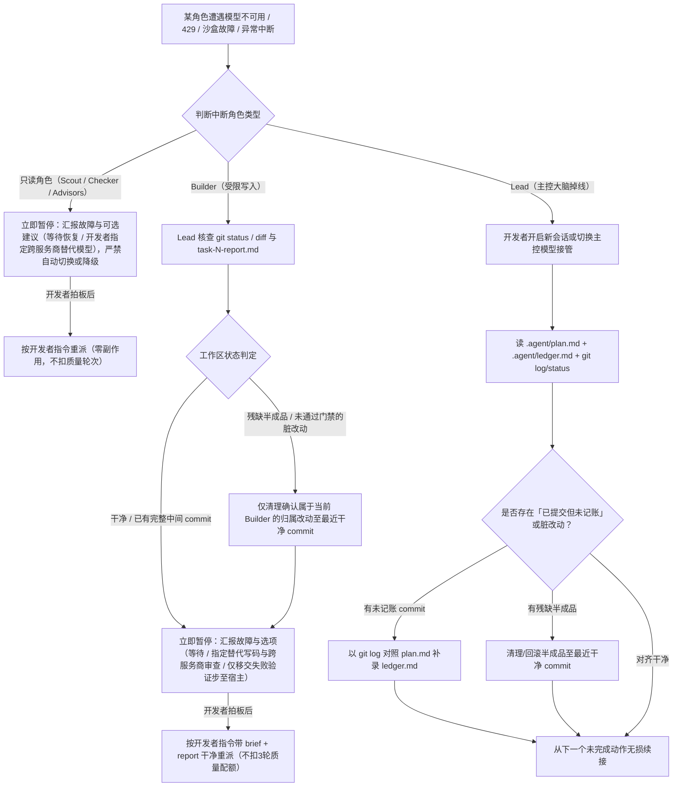

# 多 Agent 协同：额度耗尽与故障恢复推演手册

[English](../en/fault-recovery.md) | **简体中文**

> **配套主规范**：[多 Agent 协同开发架构规范](./architecture.md) · [人类介入与主动询问规范](./human-in-the-loop.md)
> **适用场景**：任一角色在执行任务中途遭遇**额度耗尽、滚动时间窗口限流（429）、余额归零或进程异常中断**时的标准处置与无损恢复操作指南（Runbook）。

---

## 一、架构天然的容错基线

在多 Agent 协同中，最危险的故障是“中断导致进度丢失、反复重跑或代码半残污染主干”。本架构通过 4 项基础设计，天然将单次断粮的**爆炸半径锁死在“当前这一个未完成的动作”内**：

1. **状态全落盘（`.agent/` + `ledger.md`）**：方案、切片 brief、审查 diff、进度账本与裁决记录均在文件系统持久保存，不依赖易失的对话内存。
2. **小提交基准（`git log`）**：每个已通过验收的切片均已独立提交，任何时候都可准确对齐到最近一个干净 commit。
3. **单写者原则**：同一时刻最多只有一条写入线程在改代码，不会出现多个并发写者半途断粮导致的跨文件合并灾难。
4. **只读角色天然幂等**：`Scout`、`Checker`、`Tech Advisor` 均无源码写权限，中断重跑零副作用。

---

## 二、三条断粮防呆铁律

遇到任何角色中途额度耗尽或限流中断，必须严格遵守以下 3 条硬规则：

1. **基础设施中断与质量失败配额分离（无同级备选、故障即暂停请示）**
   - 规范中的 **“3 轮修复熔断上限”** 仅用于衡量代码质量与门禁是否收敛；
   - 额度耗尽 / 429 限流 / 通道超时 / 沙盒故障属于**基础设施中断，不计入 3 轮质量配额**；
   - **各角色均不配置同级备选模型，严禁自动切换或静默降级**；遇到任何角色无法工作时，立即暂停并向开发者汇报具体故障与 2–3 个带利弊权衡的建议（如等待额度恢复、由开发者指定替代模型并同步确认 Builder 与 Checker 跨服务商、或仅将沙盒内失败的单个工具步骤如 `esbuild` 移交宿主），等待开发者做决定后再继续。
2. **严禁静默降级或跳过验收（No Silent Downgrade）**
   - 当 `Checker`、`Tech Advisor` 或 `Design Advisor` 不可用时，**严禁** Lead 为了赶进度悄悄降级模型或跳过审查放行；
   - 宁可安全暂停等待开发者拍板或额度恢复，也绝不牺牲质量防线。
3. **脏工作区先检后滚，绝不盲叠补丁也不误伤用户原有改动**
   - 派发任何写入角色（`Builder`）前，先记录派发前已存在的未提交改动（`pre_existing_dirty`）；若与当前切片的文件归属有重叠，先暂停确认或改用独立 worktree；
   - 发生中断后，恢复或重派前**必须先执行 `git status` 与 `git diff` 核查**：保留已通过门禁的干净中间提交，仅清理已确认属于当前 Builder 产出的残缺改动，**严禁自动回退归属不明或派发前已有的用户改动**。

---

## 三、故障恢复决策流

---

## 四、6 大角色逐一故障注入推演（Runbook）

### 1. `Scout`（侦察）中途断粮
- **风险等级**：极低（零工作区污染）
- **典型现场**：大范围探索或大日志提纯中途断开，主控未收到摘要报告；`.agent/findings/` 可能留有半成品笔记。
- **恢复 SOP**：
  1. Lead 检查 `.agent/findings/` 是否已有部分落盘索引，有价值的路径线索可直接保留作为下一轮输入的线索；
  2. 暂停并向开发者汇报中断位置与建议（等待恢复 / 指定替代探索模型 / 若范围已收缩到少数已知文件由 Lead 直接读取）。

### 2. `Checker`（验收）中途断粮
- **风险等级**：低（零工作区污染，但防偷跳过）
- **典型现场**：`task-N-review.diff` 与 `task-N-brief.md` 完整保存在盘上，审查报告未生成或输出截断。
- **差异化恢复 SOP**：
  - **任务级首审 / 全分支终审中断**：暂停并汇报具体错误与选项（等待额度恢复，或由开发者显式指定跨服务商替代审查模型），获批后喂入同一份 `brief + report + review.diff + 全局约束` 重审；
  - **增量复审（Scoped Re-review）中断**：获批恢复后仅喂入修复区间的增量 diff 与未关闭问题清单重跑；
  - **绝对红线**：**绝不允许自动切换、降档凑合或跳过审查直接推进下一切片**。

### 3. `Tech Advisor`（技术顾问）中途断粮
- **风险等级**：低（零源码污染）
- **典型现场**：L 级架构评审未输出完整方案，或 3 轮熔断后的根因诊断中断。
- **恢复 SOP**：
  1. 立即暂停并告知开发者故障详情与可选替代建议，绝不自动降级或让低档模型冒充顶级架构评审签字放行；
  2. 经开发者拍板恢复后，完整带上 `.agent/design.md` 或失败轨迹与已排除假设重跑。

### 4. `Design Advisor`（设计顾问）中途断粮
- **风险等级**：低（零业务源码污染）
- **典型现场**：分三种断点——① `.agent/design-spec.md` 写到一半；② `.agent/assets/` 配图只生成了部分；③ 运行态截图审美走查中断。
- **恢复 SOP**：
  1. 规范未写完：暂停确认恢复方式后，删掉残缺片段或基于既有半成品补全并重新校验完整性；
  2. 素材只出了一半：盘点 `.agent/assets/` 已落盘的可用文件，恢复后只补生成缺失素材（不重复浪费已成图）；
  3. 审美走查中断：暂停向开发者汇报后，用同一批运行态截图按开发者确认的模型重跑走查。

### 5. `Builder`（施工）中途断粮（最高频脏现场）
- **风险等级**：中（唯一可能污染源码工作区的子角色）
- **三种现场细分与处置**：
  1. **现场 A（零改动 / 仅读文件阶段断开）**：`git status` 干净，暂停向开发者汇报并给建议（等待恢复、或由开发者指定替代写码角色并同步确认跨服务商 `Checker`），获批后重派 `task-N-brief.md`，不扣质量修复轮次。
  2. **现场 B（已产出 1 个以上通过 `verify:fast` 的干净小 commit，在后续收尾或修复轮次断开）**：
     - 保留已通过门禁的干净 commit；
     - 清理其后的未提交半成品；
     - 经开发者拍板恢复模型后，读取 `task-N-brief.md` + `task-N-report.md` + `git log BASE..HEAD` 从当前 HEAD 接着收尾。
  3. **现场 C（留下大量未提交的残缺改动、半截测试或未写完的报告）**：
     - **安全清理**：仅针对已确认由当前 Builder 产出的切片归属文件改动回滚至 `BASE`（严禁误删 `.agent/` 里的计划与账本，严禁自动回退派发前已有或归属不明的用户改动）；
     - 暂停向开发者汇报故障与选项，获批后再从 `BASE` 干净重跑，彻底杜绝“在上一位半残逻辑上叠补丁”引入的隐性缺陷。

### 6. `Lead`（主控）中途断粮（大脑掉线）
- **风险等级**：中高（整体暂停，但可实现 100% 无损接管）
- **三种中断瞬间与接管 SOP**：
  1. **设计澄清阶段断粮**：因为实行“即答即落盘”，已确认结论全在 `.agent/design.md` 中；新 Lead 读完 `design.md` 直接接着澄清剩余未决项即可，不重复问已答过的问题。
  2. **切片执行流转中 / 刚提交切片但未来得及写 `ledger.md` 时断粮**：
     - 新会话启动后，按固定顺序执行 **3 步接管**：
       1) 读 `.agent/plan.md` 与 `.agent/ledger.md`；
       2) 运行 `git status` 与 `git log --oneline -n 20`；
       3) 以 `git log` 为准核对是否存在“已提交但账本漏记”的切片（补录 `ledger.md`），若有 M 级亲写留下的未提交半成品则按 Builder 现场 C 原则评估回滚或续接。
  3. **严禁行为**：新接管的 Lead 绝不可凭残缺对话记忆猜测进度，**一切以 `ledger.md` + `git log` 为唯一事实基准**，防止整批重派已完成切片。

---

## 五、日常防断粮与防踩坑的 4 条前置预防措施

1. **切片严格控规模（≤ ~400 行有效改动）**：切片越小，单次 `Builder` 与 `Checker` 消耗的 Token 越可控，即使偶发中途断粮，回滚重跑的沉没成本也极低。
2. **门禁前置（`verify:fast`）**：把格式、类型、依赖边界、单测失败拦在零 Token 的本地脚本层，大幅减少 `Checker` 与 `Builder` 的无效往返。
3. **执行切片前跑目标沙盒探针 + 确认各角色配置模型**：签字后、启动 Slice 1 前运行 `--smoke-test --probe-sandboxes`，提前暴露沙盒 shell / `esbuild` 限制并请开发者确认每个角色当前设置的模型（不设隐式自动备选），避免跑了一半才撞车。
4. **严格执行 S/M/L 分级与日志落盘**：避免把简单小活和数万行构建日志灌进高阶主控池，把宝贵的滚动额度全部留给真正高杠杆的设计与验收节点。

