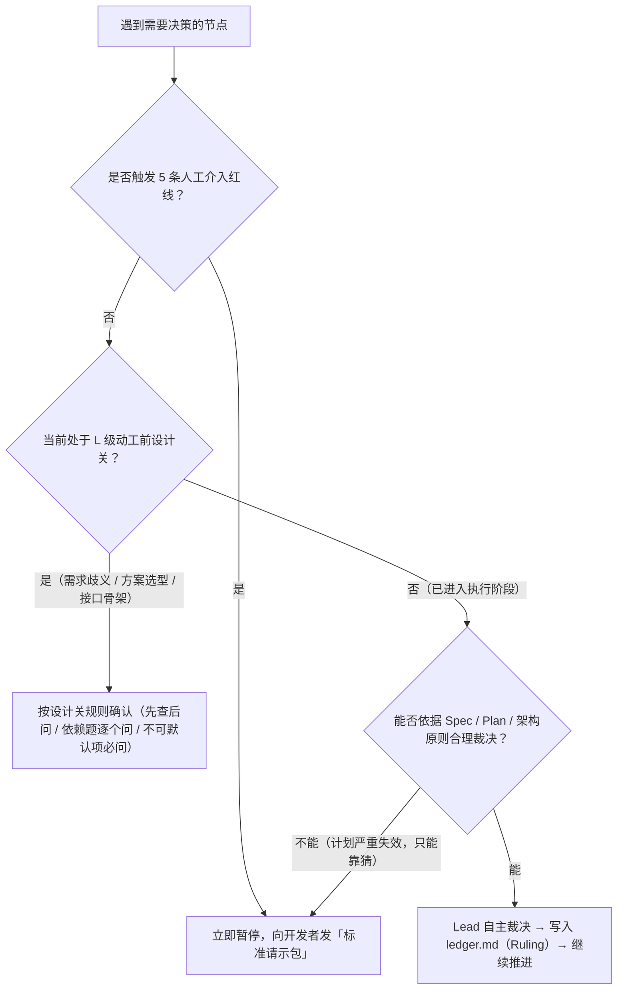

# 多 Agent 协同：人类介入与主动询问规范

[English](../en/human-in-the-loop.md) | **简体中文**

> **配套主规范**：[多 Agent 协同开发架构规范](./architecture.md)
> **核心原则**：**动工前把关键边界问清，执行中持续推进不碎嘴，仅触及 5 条不可逆红线才暂停，交付时公开全部自主裁决。**
> **设计目标**：让开发者保持 **“人类在环（On-the-loop）”**——既不因频繁琐碎提问被打断心流，也不因 Agent 静默越权而积累不可逆的技术债与认知债。

---

## 一、主动询问触发全景（按任务级别与阶段速查）

| 任务级别 | 动工前（设计阶段） | 执行中（编码/验证/修复） | 交付时（收尾阶段） |
| :--- | :--- | :--- | :--- |
| **S（小活）** | 不询问，直接改 | 仅触发 **5 条红线** 才停 | 交付改动与 `verify:fast` 结果；外部动作（合并/推送）须确认 |
| **M（常规）** | 需求清晰则不问；仅**涉及 UI/视觉**或需求有关键歧义时确认基调 | 仅触发 **5 条红线** 才停 | 交付改动、验证结果与 `Ruling:` 清单；外部动作须确认 |
| **L（复杂）** | **强制 4 步交互**：① 澄清歧义（含样例/按需 Spike）→ ② 方案取舍 → ③ 骨架签字 → ④ 切片前确认各角色配置模型 | 仅触发 **5 条红线**、**首个 UI 切片初版截图确认**或**模型/沙盒故障**才停（常规切片间与 3 轮内自修不停） | **强制验收**：一页变更叙事 + 公开全部 `Ruling:` + 人类三问复述验收 + 外部动作确认 |

### 人类介入决策流



---

## 二、阶段一：动工前的主动确认（设计闸门）

仅在 **L 级任务**（或 M 级存在核心歧义 / 面向用户的视觉设计）进入编码前触发，核心目的是把最高代价的返工消灭在写第一行代码之前：

1. **需求澄清（先查后问，依赖题逐个问，按状态收口）**
   - **先查后问 + 真实需求来源**：仓库、Spec 和已有对话能回答的问题，一律不问；开局先请开发者提供 **1 份脱敏样例**或用一句话说明**“交付物给谁、对方接着做什么”**；已经拍板的事，不重新打开。
   - **提问纪律与按需轻工具**：每题只问会改变“建什么”或“怎么验收”的问题，附一句“这个答案会改变什么”。互相依赖的问题**逐个问**；互相独立的问题可以合并成一条消息编号提问（≤3），或者直接写成默认假设公开出来。仅针对会改变方案的未决项，按需选用**输入与交付物对照**、**歧义规则判别例**或**最短操作路径**（直接复用到设计与测试，禁止强制固定多轮填表或单独骨架签字）。仅当多种合理意图会导致不同设计时才追问目的（Why，且此时不附选项防锚定）。
   - **不可默认清单（防沉默同意）**：**数据不可逆语义**（硬删/软删/保留/迁移）、**权限边界**、**对外契约 / Schema 身份规则**、**计费 / 合规**、**非目标**、**验收判据**（模糊词须量化或写成可测用例），这六类必须拿到明确答复，不能用默认假设代替，也不能埋进一长串假设里一起确认；如果要给推荐项，只能推荐保守、可逆的选项。
   - **按状态收口与签字后变更尺度**：没有会改变构建内容的未决项了就停，不设总题数上限；没问到的列入 `Deferred`。会改变方案的未决问题超过 5 个，视为任务应拆分的信号。签字后若产生新偏好，在 `ledger.md` 记录受影响的契约与验收项并按影响面定向复审。
   - **分段复述 + 即答即落盘**：每理解一块就用 200–300 字复述一次；澄清结论立刻写入 `.agent/design.md`，覆盖矛盾的旧表述；文中明确区分“**开发者原话**”和“**Lead 补充的假设（附理由）**”。
   - **两个出口（`just build it` 与 A/B/C 一次性 Spike 门禁）**：开发者未主动要求讨论时附一句跳过选项，说“直接干”即可跳过澄清，所有假设以 `Ruling:` 写入 `design.md`。仅当同时满足 **A（两种可能结果会改契约/依赖/核心操作顺序）+ B（查仓库/文档或问人看样例仍无定论，且实验能区分结果）+ C（先写 1 个问题、X/Y 判据与 5–10 分钟上限，且比写首片更省；否则缩小首片并在 `design.md` 标明暂定契约与重开条件）** 时，才做一次性 Spike：纯本地技术实测记 2 行实验卡后可直接跑，需用户试操作或扩预算须先征得同意；原型限于 `.agent/prototype/` 或临时分支，禁止导入、复制或合并原型实现，Builder 只接收写入 `design.md` 的结论与验收样例。
2. **方案取舍（提供 2–3 个备选方案）**
   - 给出 **2–3 个**结构差异清晰的技术方案，并列明各自利弊、长期维护代价与推荐项，请开发者拍板选定方向。
3. **骨架签字与执行前模型确认（Builder check + 人定骨架 + 角色模型确认）**
   - 签字前由一个**完全没有上下文的子 Agent** 对 `.agent/design.md` 做一次 **Builder check**（只问“缺什么才能直接动工”），其中“只有人能答”的问题合并为**一条消息**一次性提问，这也是本轮唯一一次批量追问；
   - 在拆切片派发给 `Builder` 之前，形成 `.agent/design.md` 及核心**接口签名、核心类型定义、持久化 Schema 骨架**，必须经开发者明确确认；
   - 若任务涉及面向用户的 UI/界面，`Design Advisor` 产出的视觉基调与核心交互规范（`.agent/design-spec.md`）一并在设计阶段确认；进入实现后，首个 UI 切片完成构建时先提交桌面/移动初版截图由开发者确认方向，再启动独立视觉盲评与多轮精修；
   - **签字后、执行 Slice 1 前**：运行冒烟与目标沙盒探针，向开发者列出各角色当前配置的模型与就绪状态，经确认后再开始切片执行。

---

## 三、阶段二：执行中的「5 条唯一人工介入红线」

一旦设计确认并进入执行阶段，Lead 必须**持续推进完所有切片**。只有撞上以下 **5 条红线之一** 时，才允许（且必须）立即暂停请示开发者：

| 红线编号 | 触发类别 | 典型具体场景 |
| :---: | :--- | :--- |
| **①** | **不可逆或破坏性操作** | 删除数据库/表/历史数据、批量覆盖非临时资产、清理未提交用户文件、不可逆数据洗数 |
| **②** | **安全敏感操作** | 改动认证/鉴权/权限模型、接触密钥或生产凭证、放宽输入校验/CORS/安全策略 |
| **③** | **影响工作区以外的外部动作** | 合并至主干分支、推送至共享远程分支、发版/线上部署、向外部系统发送消息或调用真实付费/生产接口 |
| **④** | **计划严重失效，只能靠猜** | 深入代码后发现前置架构假设崩塌、Spec 与现实系统存在无法调和的根本矛盾，连 Lead 也无法基于 Spec 做出合理裁决 |
| **⑤** | **触及长期架构的 4 类高代价变更** | • 变更**持久化 Schema / 数据库迁移**（含任何破坏性字段变更）；<br>• 变更**对外公开契约**（对外 API、SDK、跨服务事件格式）；<br>• 修改**护栏配置文件**（lint / 类型严格度 / 架构边界规则 / CI 门禁 / 阈值或 baseline）；<br>• 引入**新的第三方依赖**（`AGENTS.md` 依赖白名单之外的新库） |

### 暂停时的「标准请示包」格式
Lead 触发红线暂停时，**严禁只丢一句报错或开放式问题（如“这里报错了怎么办？”）**，必须提交结构化请示包：
1. **触发了哪条红线**（1 句话说明位置与事实）；
2. **备选方案（2 个）**（标明每个方案的影响面、可逆性与代价）；
3. **Lead 的推荐方案与理由**（开发者只需回复“选 A / 选 B / 补充意见”即可恢复推进）。

### 补充：模型不可用、额度耗尽或沙盒故障时的暂停边界
当任一角色中途遇到模型不可用、额度耗尽、429 限流或沙盒故障（详见 [额度耗尽与故障恢复推演手册](./fault-recovery.md)）：
- **不配置同级备选模型，严禁自动切换或静默降级**（该类基础设施中断不扣 3 轮质量配额）；
- Lead **必须立即暂停**，汇报具体故障与 2–3 个带利弊权衡的可选方案（例如等待限流窗口恢复、由开发者指定替代模型并同步保持 Builder 与 Checker 跨服务商、或仅将沙盒失败的单个工具步骤移交宿主机），等开发者拍板后再继续——**严禁为了避免打扰开发者而悄悄换模型或跳过 `Checker` 验收**。

---

## 四、阶段三：交付时的验收与公开裁决

全部切片通过最终全分支审查（及必要的复测/UI 走查）后，Lead 向开发者发起交付确认，包含 3 项必选内容：

1. **一页变更叙事与模块影响图（L 级必含）**
   - 简明交代本次改动涉及的模块边界、数据流向、新增的架构不变量与回滚路径。
2. **公开全部自主裁决清单（`Ruling:`）**
   - 按时间顺序全量汇总 `.agent/ledger.md` 中的所有 `Ruling:`，杜绝任何“秘密决定”；
   - 每条严格按三段式呈现：
     ```text
     Ruling: <我替你做的决定> — <依据与理由> — <若判断错误的代价与返工方式>
     ```
3. **人类「三问复述验收」与外部动作确认**
   - 开发者验收 L 级交付时，应能清晰回答三问以消除认知债：① **改了哪条模块/数据边界？** ② **新增了哪个核心不变量？** ③ **出问题怎么回滚？**
   - 确认无误后，再由开发者授权执行合并、推送或发布等外部动作。

---

## 五、反向边界：明确「禁止打扰开发者」的 5 类情况

为防止 Agent 退化为“步步请示的实习生”，以下 5 类情况**严禁暂停询问开发者**，由系统按既定机制消化：

| 场景 | 禁止行为 | 正确处理方式 |
| :--- | :--- | :--- |
| **1. 常规局部细节与轻微歧义** | 停下来问变量命名、辅助函数拆法、非核心错误文案、局部实现风格 | Lead 依据 Spec 与仓库黄金样板直接拍板，在 `ledger.md` 记一条 `Ruling:` 后继续推进 |
| **2. 切片之间的进度流转** | 每做完一个切片就发进度汇报并问“是否继续下一个任务？” | 记账后立即自动派发下一个切片，连续跑完全部计划 |
| **3. 3 轮以内的门禁红灯与审查打回** | 刚出现一次编译错误、单测失败或 Checker 打回就喊人工救火 | 走标准内部修复循环（前 2 轮续接原 Builder，第 3 轮升档）自行收敛 |
| **4. `Minor` 级审查建议** | 把轻微风格或小优化逐条发给开发者确认要不要改 | 记入账本为 `deferred minor`，留待全分支终审统一处理，不进入修复循环 |
| **5. 3 轮熔断但未触及计划崩塌** | 只要熔断就立刻甩锅给开发者 | 先由 Lead 结合 `Tech Advisor` 诊断；若属可局部兜底或可安全暂缓项，给出最小裁决并记入 `Ruling:` 继续推进（仅当暴露**红线 ④ 计划严重失效**或**红线 ⑤ 高代价变更**时才打断开发者） |

---

## 六、可直接复用的 Lead 调度约束模板

可直接节选以下段落写入根目录 `AGENTS.md` 或 Lead 调度提示词中：

```markdown
## Human-in-the-Loop & Escalation Rules
- **Before coding (L-level only):** Read the repo before asking; never ask what the repo/spec answers. Ask only questions that change what gets built or how it is accepted — dependent questions one at a time, independent ones batched (≤3) or stated as explicit assumptions. Never default on: data irreversibility, permission boundaries, public contracts/schema identity, billing/compliance, non-goals, acceptance criteria. Stop when nothing decisive is open (list the rest as Deferred), not at a fixed count. Play back understanding per chunk; write answers into `design.md` (user's words vs. your assumptions kept separate). Before sign-off, run a context-free builder check on `design.md` and batch its human-only questions in one message. Then present 2–3 approaches and get sign-off on `design.md` plus core interfaces/schemas.
- **During execution:** Execute continuously across all slices without asking "Should I continue?". Make rulings grounded in the spec for routine ambiguities and record every ruling in `.agent/ledger.md` as `Ruling: <decision> — <why> — <cost if wrong>`.
- **Stop and ask the human ONLY when hitting one of these 5 red lines:**
  1. Irreversible or destructive operations.
  2. Security-sensitive changes (auth, secrets, permission boundaries).
  3. Side effects outside the current workspace (merge, push to shared branch, deploy/publish).
  4. Severe plan failure where every path forward is a guess.
  5. Changes to persistent schemas/migrations, external public contracts, guardrail configs (lint/type/arch/CI), or adding a new third-party dependency.
- **When pausing:** Provide (1) which red line was hit, (2) 2 concrete options with trade-offs, and (3) your recommended choice.
- **On model/quota/sandbox failure:** Treat as infra failure (do not count against the 3-round quality cap). No same-tier fallback models are configured—never auto-switch, silently downgrade `Checker`/advisors, or skip verification. Pause immediately with the concrete error and 2–3 actionable options for the human's decision. Clean only confirmed Builder-authored incomplete mutations back to `BASE` before retrying (never revert pre-existing user edits).
- **On delivery:** Present all recorded `Ruling:` entries verbatim in chronological order, plus a one-page change narrative (boundaries changed, new invariants, rollback path) for L-level tasks.
```

